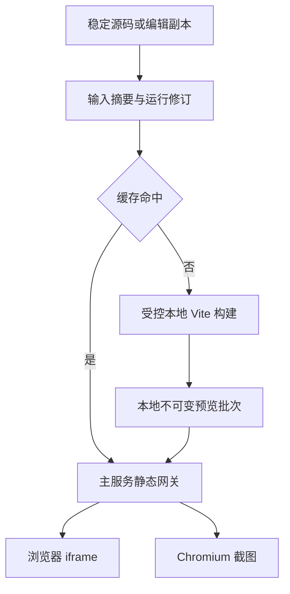

# 本地预览、截图与在线编辑

## 三类输入

| 模式 | 输入 | 保存与更新 |
| --- | --- | --- |
| 当前会话 | 当前稳定文件、配置和资源修订 | 事件驱动自动构建，复用最近成功结果 |
| 暂存版本 | 冻结版本文件集合 | 同一版本维持固定结果与公开访问标识 |
| 在线编辑 | 从工作文件创建的临时编辑副本 | Redis 保存状态，本机增量编译，显式应用回会话 |

## 构建和访问

社区版固定使用本地 Node/Vite。`npm run prepare:preview` 提前准备预览模板、截图依赖和版本匹配的 Chromium，运行请求不临时安装依赖。`container/build.mjs` 是固定脚本的历史目录名，执行方式为本机 Node 子进程。

编译器在独立临时输入和工作目录内处理源码，输出静态 HTML/CSS/JS。模板使用受控 Vite 配置，关闭项目配置自动发现、任意包脚本和安装命令。子进程只接收白名单环境，不向其传递模型、数据库等服务端凭据；这不等于操作系统层面的文件访问隔离。

输出存入服务端本地缓存，通过 `/H5_Preview/` 或 `/RN_Preview/` 网关访问。私有页面从本地缓存读取，使用短票据并复查会话权限；公开版本从对象存储读取登记产物，链接长期复用；网关始终核对路径、登记资源和内容类型。浏览器执行生成页面时保留 opaque iframe sandbox 与 CSP，不向生成页面注入登录 Cookie 或密钥。

本地进程与主服务共享账号、CPU、内存和文件系统权限，不应宣传为容器隔离。固定模板和文件校验只能限制允许行为，不能代替部署方的资源和运行安全边界。

## 单位与视觉效果

H5 编译对 CSS/SCSS 中的 px 执行 px→vw，换算基准来自生成配置的 outputBase；已有 vw、字符串、URL 和依赖样式不重复转换。PostCSS 不改写 React 内联 style 或 JavaScript 数值。

RN 使用 React Native Web、StyleSheet 和图片适配，rpx 缩放独立处理。浏览器预览不能代替手机原生验收。字体、浏览器版本和资源加载也会影响截图，需同时检查控制台、资源与截图结果。

## 缓存和清理

- 通用缓存以批次摘要校验完整性，默认按最后使用时间约 30 天和容量清理，源代码与对象存储是可重建事实源。
- `.runtime/previews` 等目录保存本机缓存；同会话的选择状态稳定，不意味着每次请求都重编译，也不保证容器重建后磁盘仍存在。
- 编辑临时状态保存在 Redis，编辑预览位于独立目录；常驻增量上下文默认空闲两分钟回收，临时状态期限由 `edit/store.ts` 定义。
- 公开链接长期有效与本地缓存保留是不同概念。公开版本网关从对象存储读取产物，不依赖会话的本机缓存；会话缓存缺失可按固定快照重建，多实例部署需考虑本地缓存可达性。

## 在线编辑和反馈修复

Monaco 支持目录、源码编辑、全文搜索和源码定位。选择入口后按当前编辑修订生成预览；待保存的编辑不会直接改写会话文件。显式应用时检查归属、基线和活动执行，事务提交稳定文件后通知页面更新。

截图可作为用户对话附件，Agent 结合选中元素、源码、设计稿与预览结果进行修改。元素审查通过带随机标识的消息桥传递选择器、尺寸和样式，服务端网关注入受控脚本；普通文件预览仍只展示内容。

生成中缺少明确待保存的同目录文件时显示 `waiting_files` 并保留上次成功预览；活动状态结束后恢复真实缺文件错误。语法错误、依赖缺失、越界请求和版本输入不被该状态掩盖。

固定模板运行方式见 [预览模板说明](../../preview-template/README.md)，当前业务结构见 [架构文档](../../doc/architecture.md)。
