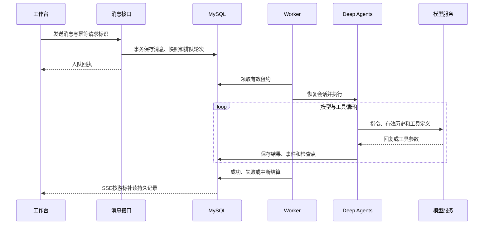

# Agent 执行、检查点与恢复

## 一次消息的调用链

主要入口为 `session/messages.ts` → `run/worker.ts` → `run/execute.ts` → `run/agent/run.ts` → `run/agent/agent.ts`。工具由服务端注册，模型决定调用名称和参数，框架执行对应函数并将结果交回模型。

## Worker、并行和租约

Worker 定期读取数据库候选，在事务内核对当前状态和会话占用后领取租约。`concurrency` 限制本实例同时运行数量，多实例仍依赖数据库资格检查。租约保护持久写入和结算，续租失败不能继续保存。

请求入队与后台执行分开，HTTP 连接关闭不取消工作。Redis 通知用于加速前端时间线补读，不是唯一任务队列，也不代替数据库持久状态。

## 检查点与历史

会话固定 `thread_id`。LangGraph 在图执行时保存状态、中间写和父链，服务通过 MySQL checkpointer 恢复。业务文件修订与时间线经原租约事务保存，不能假设三种保存是一个原子动作。

用户消息、模型回复和工具调用/结果保留完整配对。首次导入历史，后续追加稳定 ID；中断时补齐可核实的未知结果标识，严重损坏的配对明确阻止继续。原生业务问题按对应中断检查点回答，不追加伪造确认，也不无条件新开任务。

模型工具请求按 DeepSeek 协议回传每条助手消息的真实思考字段；旧会话缺失时仅在出站请求补空字符串。普通流、原生流、摘要和平台消息重建共用兼容约定，原始历史及成功工具回执保留，其他模型协议保持原样。范围与回归见[工具调用思考字段回传](../topics/deep-agents-execution.md#工具调用思考字段回传)。

## 上下文、摘要与用量

摘要完成后先保存覆盖前缀的私有回执，再请求正常生成。后续生成失败与进程重建可复用严格匹配的摘要；压缩后按预算保留近期完整消息组、当前要求及最新失败证据。完整历史和差异拒绝边界见[摘要复用与压缩空间](../topics/deep-agents-execution.md#摘要复用与压缩空间)。

`contextBudgetTokens` 使用本地估算器并预留余量。有效上下文达到可用预算的约 70% 时触发摘要，保留近期消息组；摘要前保存完整消息归档供工具分页回查。父、子上下文隔离，归档不是用户代码产物。

大工具输出按分页和外置资源处理，已完成局部写入可压缩模型视图，失败或未知操作保留原参数。摘要本身也消耗模型请求；不能把每次继续都当作必须重新摘要的流程。

主模型、子模型和摘要请求共享 `maxTurns`。供应商返回的输入/输出/总 Token 逐次持久化，失败或取消前已完成请求仍统计；没有返回用量标为缺失，不能按零费用处理。

## 子 Agent 与质量收口

角色包含只读设计/复核，以及受精确写路径约束的规则扫描/UI 实现。子任务的模型和图状态独立，实际文件由原稳定存储提交。子任务只能读取允许范围，不能任意联网、安装包或执行生成代码。

执行角色可并行委派，路径重叠则拒绝。子任务完成需要实际保存授权产物和真实校验；接受委派不代表完成。主任务在依赖、合并、预览和结束前收取结果，负责自身区域与最终必要验收。

同一份完整且版本未变的资源优先复用。规则报告可增量合并，保留已有命中；修复必须针对真实缺陷，不能因页面已完成仍反复重写无关内容。`edit_file` 支持摘要保护下的唯一片段替换。

## 中断边界与诊断

`runTimeoutMs` 限制单轮活跃时间。服务重启、租约过期或短时网络故障是否自动恢复，由 `worker.ts`、`leases.ts` 和 `session/messages.ts` 的分类决定；不能承诺所有错误无限自动重试。用户手动停止、存储失败及权限问题仍保留各自保护。

图步数与模型请求数分别计量：当前每段 2048 步，检查点有效且存在持久进展时最多自动恢复两段；没有进展或达到限额会交回明确未完成信息。恢复前复查稳定文件与未知工具，不能重复未知写入。

聊天与执行诊断的耗时包含排队，等待业务回答时暂停；回答重新入队后续计，最终耗时扣除每次等待区间。刷新按持久化生命周期重算，缺失时间保持未知；规则详见[诊断统计范围](../topics/deep-agents-execution.md#子agent执行诊断)。

`modelActivity.ts` 记录模型开始、首块和结束阶段；`diagnostics.ts` 汇总轮次与用量。第一块只接受真实正文、思考或工具片段，空角色块不算；无首块时保留未知。服务请求编号按白名单保存，不能把首块前耗时直接解释为内部排队。

排查从轮次状态、errorId、runId、具体工具和服务端诊断开始。工具脚本分类详见工作区主题，预览错误详见预览主题；历史缺失的原因无法补造。

后台子任务按原agentId恢复，严格核对授权；输入或文件变化转为局部复核与主Agent交接，恢复不重复消耗委派额度。原结果与检查点保留，存储及租约故障继续中止，见[稳定身份恢复](../topics/deep-agents-execution.md#后台子任务稳定身份恢复)。

子模型请求超时与连接异常在原图中有限重试，保留成功工具结果与真实模型失败分类；详见[子模型网络故障](../topics/deep-agents-execution.md#子模型网络故障与有限重试)。

## 规则修复交接与图片证据

UI检查连续两轮无改善时，由平台以RULE_REPAIR_STALLED交回主Agent，保留已保存文件、失败结果及原上下文；主Agent按剩余缺口接管，避免原样重复委派。主流程继续负责最终整合与真实验收。图片规则只聚合实际静态依赖范围的区块清单，R02仍要求真实引用。比较字段、检查点恢复、冻结资源生效及回归边界见[执行专题](../topics/deep-agents-execution.md#ui规则修复无进展交接)。

## 子Agent诊断概览

执行诊断按平台子任务ID展示职责、耗时、模型请求、Token、规则变化和交付；主任务与历史未归属请求分别统计，缺失数据保持未知。模型及摘要归属、只读查询上限、并行耗时和部署边界见[执行专题](../topics/deep-agents-execution.md#子agent执行诊断)。

## UI任务前置条件与编译反馈

启动UI前核对区块报告，缺失依赖交回父级；编辑参数和路径权限提供具体反馈，主模型只读接收去重后的自动编译失败。完整准入、恢复与权限边界见[执行主题](../topics/deep-agents-execution.md#ui任务准入与编译反馈)。

## 会话错误诊断（2026-11-21）

- 执行错误筛选同步更新统计，选项数量由服务端同快照按其余条件计算；模型用量在上，错误区域默认折叠，记录使用独立卡片。具体口径见[会话错误诊断](../topics/deep-agents-execution.md#会话错误统计与排查明细)。

- 执行诊断新增会话全部轮次的错误总数、分类明细和复制排查信息；工具纠正、规则未通过分项展示，正常暂停/取消不计错误。跨层失败按明确编号去重，实际失败重试分别保留。
- `run/errorDiagnostics.ts` 仅统计保存事件与安全终态投影，冻结水位分页、限制扫描范围并标记历史覆盖；权限每次检查，未知或读取失败不显示零。新模型/子任务失败保存固定分类与关联编号，不返回原始响应或堆栈。
- 当前实现不变更表结构、正文存储或历史数据；详细统计与恢复口径见 [执行主题](../topics/deep-agents-execution.md#会话错误统计与排查明细)。

## 检查点和中间写入外置

检查点、元数据及pending writes的新正文统一加密存文件，数据库保存小引用。单条正文超过单文件上传上限时分块，并用加密清单绑定分块顺序、范围、总字节和摘要；整条当前上限128MiB。上传、核验、分块或总量超限均明确失败。旧BLOB优先读取、旧单文件引用继续兼容，原typed编码与父链语义保留。

配置需保留已就绪的引用列及独立加密密钥；旧mode/thresholdBytes参数兼容解析，执行状态的新写策略统一文件化。源码正文和时间线沿各自现有策略。 分块引用需要新版本读取器，发布时统一升级执行进程；旧程序回滚前通过新版本显式恢复所需BLOB并核定数据库报文容量。实现与故障边界见[执行状态外置约定](../topics/deep-agents-execution.md#检查点和中间写入外置)。

上传不持有租约数据库锁，提交仍走原租约验证；普通重复写跳过无用上传，大批次逐项准备。历史迁移提供无锁预演、按空闲会话分批/CAS、断点续迁及精确BLOB回填，显式保留原更新时间。新引用缺失或损坏不静默重建执行图。配置/SQL及部署、备份和旧程序回滚顺序见[第二阶段实施说明](../req-docs/large-content-storage_第二阶段方案.md)。

真实环境的跨Worker恢复、写入/恢复延迟及空间回收仍需部署验收。时间线外置、通道级增量和历史保留/GC另行设计，不自动删除历史或依据相同大小去重。

工具参数纠错提供字段、类型与合法取值，可选字段按正式默认行为省略；连续编辑使用最新摘要，缓存由平台维护。H5检查器解析静态CSS/SCSS作用域，已有冻结规则须更新资源；子任务失败保存安全原因，工具恢复只认同轮同对象的后续明确成功，历史缺失保持未知。详见[工具参数纠错与历史排查边界](../topics/deep-agents-execution.md#工具参数纠错与历史排查边界)。

## 执行兼容与重复失败边界

本次实现的准入、完成判断及真实失败边界见[执行前置条件与减少无效重试](../topics/deep-agents-execution.md#执行前置条件与减少无效重试)；历史事件不回写，无需新增运行配置或数据库表。

## 上下文与资料读取效率

模型与摘要共用读取去重和成功写入视图；图片按单次请求准备，UI优先消费规则与区块证据。完整历史、角色边界和复验口径见[上下文复用与资料读取](../topics/deep-agents-execution.md#上下文复用与资料读取)。

## 数据库事务死锁与诊断

已确认回滚的纯数据库事务遇ER_LOCK_DEADLOCK可用新事务最多重试两次，短退避并重验租约；普通回调默认不重放。检查点正文与图片上传、模型调用保持在事务重试边界之外，本地修订仅在提交后推进；中间写按idx固定锁序。提交后异常、提交结果不确定和非死锁故障不自动重放。数据库固定错误码、编号和SQLSTATE进入执行诊断，SQL与绑定值仍不公开。详见[执行主题](../topics/deep-agents-execution.md#数据库事务死锁与诊断)。

公共发行脚本只在Skill YAML frontmatter之后插入字体说明，并兼容规范化旧包的文首说明，保持框架技能发现和重复发行幂等。

## 生成执行效率与复验

后台子任务按完成收取与修复阶段定期真实截图见[生成期调度与修复复验](../topics/deep-agents-execution.md#生成期调度与修复复验)。局部限额与整轮预算分开提示，原文件与上下文用于接续，历史未知原因保持未知。

端到端提速不能由功能回归通过直接推断：固定批次截图有额外开销，调度收益取决于任务已入队；进一步减少模型重复生成仍属后续优化。按相同设计、模型及验收标准比较总耗时、模型请求与重复修改，详见[耗时收益与验收口径](../topics/deep-agents-execution.md#耗时收益与验收口径)。

## 交互增量修改与验收收敛

已有页面交互修改按有效源码进展安排验收，保留版本绑定的局部编辑与动作计划，并以改前运行预览检查外观变化。历史成功大源码按版本完整归档供回读；参数反馈共用编辑契约，执行、动作和视觉结论分别说明。计数、恢复、推理与发布边界见[交互增量执行约定](../topics/deep-agents-execution.md#交互增量修改与验收收敛)。

## 数据库失败的底层诊断

执行错误的排查明细与复制信息展示固定数据库类型、错误码、操作、事务阶段及尝试次数；真实驱动编号与SQLSTATE独立保留。取连接超时、行锁冲突和提交阶段故障据实际字段区分，历史缺失字段保持未知。服务发布后自动采集，无新增SQL迁移或运行配置；不会输出SQL、绑定值、正文或密钥。

死锁是多个事务互相等待彼此持有的锁，索引记录与间隙锁也可能参与；单条异常只能定位本次失败，完整互锁关系仍以数据库死锁记录为准。现有有界重试与外部副作用保护沿用。字段及提交结果边界见[执行诊断约定](../topics/deep-agents-execution.md)。

## 区块校验范围与跨轮恢复诊断

区块检查使用委派时已核实的节点范围，普通继续沿用完整历史归档与按需回读，诊断分别展示当前轮、关联恢复链与整会话。具体授权边界、计时与用量缺失口径见[执行专题](../topics/deep-agents-execution.md#子agent执行诊断)及[上下文复用](../topics/deep-agents-execution.md#上下文复用与资料读取)。真实耗时与生成质量按同稿、同模型和相同验收标准比较；离线回归不代表已取得固定提速幅度。无需新增表或运行配置。

## 默认页面目录

H5与RN首次生成的默认入口为pages/home/index（按目标使用jsx或tsx），旧包和已有页面保持原路径，自定义根按配置执行。已有工作区需显式调整output.dir；详见[输出约定](../topics/deep-agents-execution.md#局部编辑与输出约定)。

## RN规则与扫描交接效率

RN直接属性数值解析、原生扫描待判断视图与完整交付、模型准备分段及安全收尾约定见[执行主题](../topics/deep-agents-execution.md#rn规则与扫描交接效率)。规则脚本随固定资源冻结，已有工作区显式升级后生效；无新增数据库表或运行配置。离线回归验证功能边界，同稿端到端收益仍需发布后测量。

### 续作预算生效范围

手动继续的新轮次采用当前项目配置的整轮次数和时限，幂等重试使用已创建快照；自动恢复继续扣减原额度。个人模型连接和凭据仍绑定原轮次。摘要请求与摘要触发轮次分别统计，分批处理不等于失败重试。验证入口见[执行专题](../topics/deep-agents-execution.md#手动续作的执行预算)。
