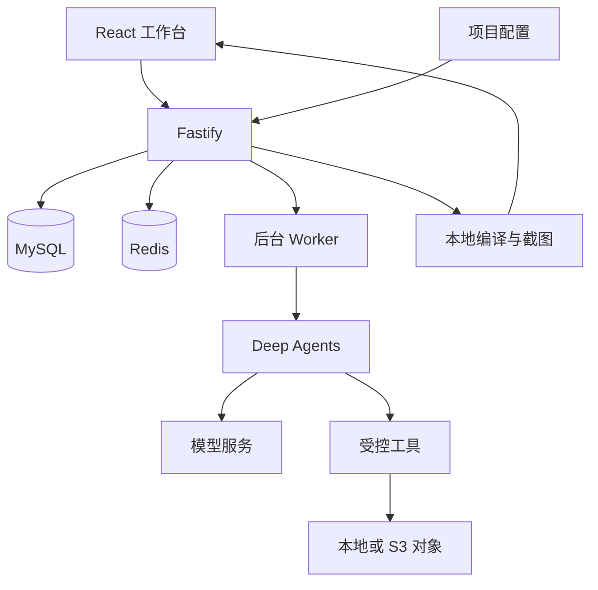

# 项目架构

## 入口与路由

| 文件或目录 | 职责 |
| --- | --- |
| `src/index.ts` | 创建应用、按配置监听、处理 SIGTERM/SIGINT |
| `src/app.ts` | 初始化工具、登录、业务路由、文件服务和预览网关 |
| `src/hooks/tools/` | 标准 MySQL、Redis、本地运行配置、Pino、存储与加密 |
| `src/hooks/http/` | 本地身份、登录守卫和访问日志 |
| `src/functions/d2c/` | D2C 业务、任务执行、文件、版本、预览与团队 |
| `src/models/` | Sequelize 业务模型和 Agent 检查点模型 |
| `web/` | React 工作台和 Monaco 编辑器 |

浏览器访问主站页面；API 统一使用 `/api/d2c`。`/health` 提供基础健康响应。`/api`、`/files` 和预览资源请求未命中时返回 404，其他页面路径可回退前端入口。

## 请求身份与接口响应

本地账号由 `auth.users` 提供，密码保存为 scrypt 哈希。Cookie 载荷带用户 ID、签发时间和失效时间，通过 HMAC 校验；删除账号或更换会话密钥会影响已有登录。个人 API Token 在服务端做摘要比较，不能因为请求携带用户 ID 就授予权限。

`request.getUser()` 返回当前账号信息，`getUid()` 获取并缓存当前请求的用户 ID，`getCid()` 使用请求编号。团队权限与工作区归属仍由业务服务查询，不由前端决定。

普通接口通过 `src/common/response.ts` 返回 `resultCode`、`resultMessage`、`success` 和 `data`；分页增加 `rows`、`total`。SSE、下载和静态文件遵守各自响应格式。

## 数据库与运行资源

MySQL 使用 Sequelize 和标准连接配置。`src/models/index.ts` 注册模型，`src/hooks/tools/mysql.ts` 建立并验证连接，关闭失败连接。`npm run db:init` 对已有数据库执行 `sync({ force:false, alter:false })`，只创建缺失表；后续字段变更需要单独审核迁移，不能把初始化当作自动升级工具。

Redis 保存通知和短期协调状态。MySQL 是任务、会话、历史、检查点与文件修订的持久事实源。Pino 输出结构化业务日志，按配置的等级写标准输出，日志平台由部署方接收。

## 开发、构建和部署

1. 安装 Node.js 24 和锁定依赖。
2. 使用 `npm run setup` 生成本地配置，填写数据库、Redis、模型和存储。
3. 执行 `npm run db:init` 创建缺失表。
4. `npm run dev` 开发；`npm run build` 构建前后端；`npm start` 运行构建结果。
5. 预览依赖用 `npm run prepare:preview` 准备，图片压缩依赖用 `npm run prepare:images` 准备。

Dockerfile 是整个应用的部署方式之一。该镜像构建时安装固定依赖，运行时由入口脚本保护配置文件权限；Compose 的数据库初始化流程与普通 `npm start` 需要区分。持久化数据库、Redis、对象目录和部署配置，不能依赖临时容器目录保存业务数据。

函数采用 JSDoc，使用项目内 Prettier。类型检查、测试和构建命令见根 `package.json`；部署环境仍须验证实际网络、模型、文件读回与浏览器截图。

## 数据库安全诊断

访问日志和后台执行共用固定数据库码投影，原始SQL、绑定值和凭据保持私有；见[架构主题](../topics/project-architecture.md#数据库错误日志)。
