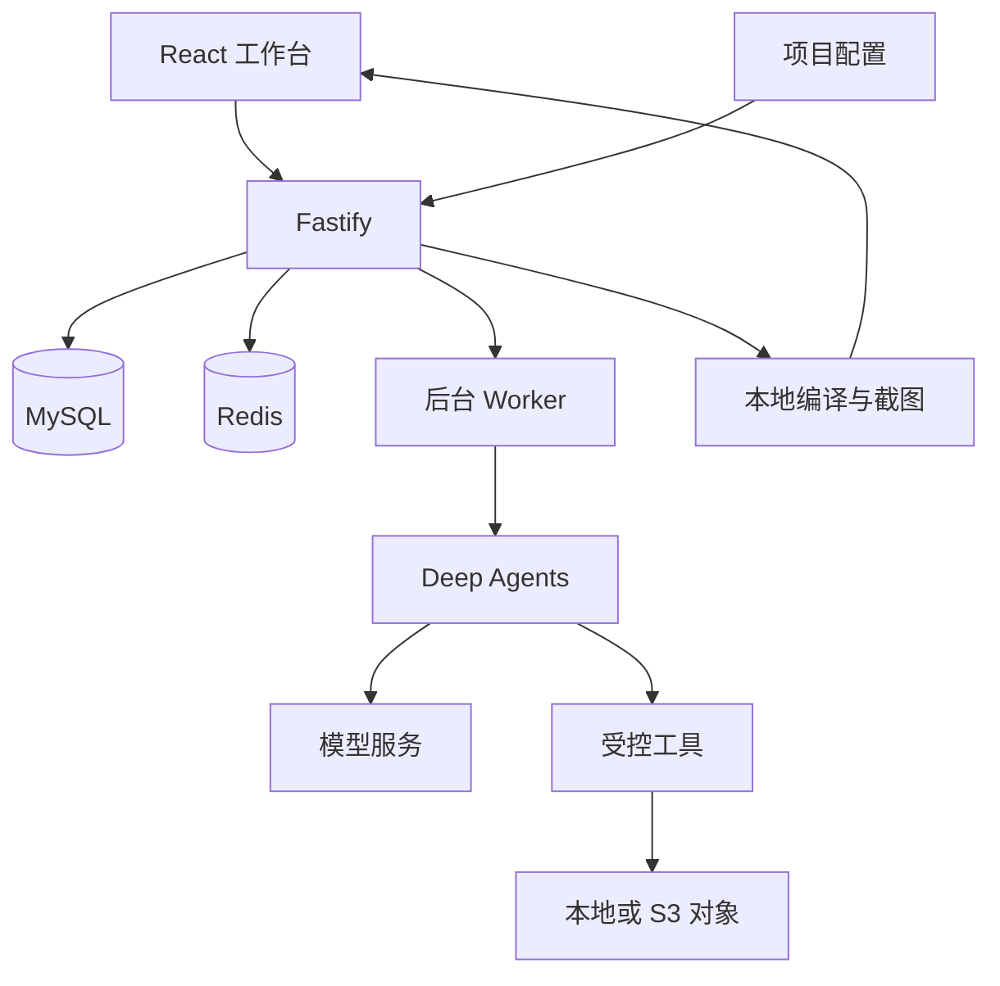

# 项目架构

## 入口与路由

| 文件或目录 | 职责 |
| --- | --- |
| `src/index.ts` | 创建应用、按配置监听、处理 SIGTERM/SIGINT |
| `src/app.ts` | 初始化工具、登录、业务路由、文件服务和预览网关 |
| `src/hooks/tools/` | 标准 MySQL、Redis、本地运行配置、Pino、存储与加密 |
| `src/hooks/http/` | 本地身份、登录守卫和访问日志 |
| `src/functions/d2c/` | D2C 业务、任务执行、文件、版本、预览与团队 |
| `src/models/` | Sequelize 业务模型和 Agent 检查点模型 |
| `web/` | React 工作台和 Monaco 编辑器 |

主站根路径提供独立宣传页，/workbench提供React工作台；旧查询式业务入口与SPA深链继续兼容。API 统一使用 `/api/d2c`。`/health` 提供基础健康响应。`/api`、`/files` 和预览资源请求未命中时返回 404，其他页面路径可回退前端入口。

## 请求身份与接口响应

登录页提供 GitHub OAuth、访客和本地账号入口。GitHub 账号按官方返回的稳定数字 ID 生成 `github-<id>`；访客由服务端生成 `guest-<uuid>`，在当前浏览器的固定有效期内复用。Cookie 携带签名身份、显示名称和时限；本地账号仍从 `auth.users` 实时复查，密码为 scrypt 哈希。两个外部前缀为保留命名空间。个人 API Token 保留本地账号认证方式。

GitHub 使用浏览器 nonce、Redis 中十分钟有效的一次性 state 和 PKCE，回调在兑换授权码后读取官方用户信息；GitHub Token 仅用于本次读取，不落库或进入会话。配置开关关闭后对应会话失效。登录页使用 `Referrer-Policy: same-origin`，确保浏览器表单携带本站 Origin；OAuth 跳转和回调继续使用 no-referrer。请求日志按路由输出，反向代理须对回调关闭含查询串的访问日志。

访客默认最多 24 小时，受平台会话上限约束；退出、清除 Cookie 或过期后无法找回该临时身份。数据仍按既有存储保留，登录 GitHub 会成为独立账号，不自动迁移访客所有权。GitHub 和访客的 AI 任务必须绑定本人模型凭据，平台模型 Key 在入队和执行阶段均不能回退使用。

`request.getUser()` 返回当前账号信息，`getUid()` 获取并缓存当前请求的用户 ID，`getCid()` 使用请求编号。团队权限与工作区归属仍由业务服务查询，不由前端决定。

普通接口通过 `src/common/response.ts` 返回 `resultCode`、`resultMessage`、`success` 和 `data`；分页增加 `rows`、`total`。SSE、下载和静态文件遵守各自响应格式。

## 数据库与运行资源

MySQL 使用 Sequelize 和标准连接配置。`src/models/index.ts` 注册模型，`src/hooks/tools/mysql.ts` 建立并验证连接，关闭失败连接。`npm run db:init` 对已有数据库执行 `sync({ force:false, alter:false })`，只创建缺失表；后续字段变更需要单独审核迁移，不能把初始化当作自动升级工具。

Redis 保存通知和短期协调状态。MySQL 是任务、会话、历史、检查点与文件修订的持久事实源。Pino 输出结构化业务日志，按配置的等级写标准输出，日志平台由部署方接收。

## 开发、构建和部署

1. 安装 Node.js 24 和锁定依赖。
2. 使用 `npm run setup` 生成本地配置，填写数据库、Redis、模型和存储。
3. 执行 `npm run db:init` 创建缺失表。
4. `npm run dev` 开发；`npm run build` 构建前后端；`npm start` 运行构建结果。
5. 预览依赖用 `npm run prepare:preview` 准备，图片压缩依赖用 `npm run prepare:images` 准备。

Dockerfile 是整个应用的部署方式之一。该镜像构建时安装固定依赖，运行时由入口脚本保护配置文件权限；Compose 的数据库初始化流程与普通 `npm start` 需要区分。持久化数据库、Redis、对象目录和部署配置，不能依赖临时容器目录保存业务数据。

函数采用 JSDoc，使用项目内 Prettier。类型检查、测试和构建命令见根 `package.json`；部署环境仍须验证实际网络、模型、文件读回与浏览器截图。

## 数据库安全诊断

访问日志和后台执行共用固定数据库码投影，原始SQL、绑定值和凭据保持私有；见[架构主题](../topics/project-architecture.md#数据库错误日志)。

## 自主部署入口

默认compose.yaml组合应用、MySQL与Redis，compose.external.yaml保留应用及持久卷，外部连接由私有配置提供。可选构建代理覆盖文件只影响镜像下载；运行代理与公网入站访问分开配置。文档和README统一从[自主部署指南](../../docs/deployment/部署与配置.md)进入，在线实例为[pp.lantao.work](https://pp.lantao.work/)。

## 自动部署与固定资源

src/paths.ts按模块位置定位模板、静态页面与预览工具。GitHub Actions检查分支与PR，仅main且配置服务器后发布；专用受限SSH命令、指纹核验、发布锁、精确源码与产物校验、绑定镜像的依赖指纹和健康回滚见[自动部署指南](../../docs/deployment/自动部署.md)。私有配置及数据卷原位保留，真实模型/Figma和视觉质量仍需业务验收。

CI runner固定Ubuntu 24.04，避免ubuntu-latest升级系统后与锁定Playwright系统依赖不兼容；生产镜像的Debian Bookworm运行环境独立。

## 公开宣传首页

静态首页展示设计到代码流程、本地版与服务版选择，仓库入口分别为公开PixelPrint和PixelPrintService。在线入口固定为/workbench；根路径历史业务查询交给原SPA解析。默认登录进入工作台，显式合法站内回跳保留；公开页面不读取凭据，API权限保持原约定。页面源文件为web/public/landing.html及assets/landing.css，发布构建自动复制。
