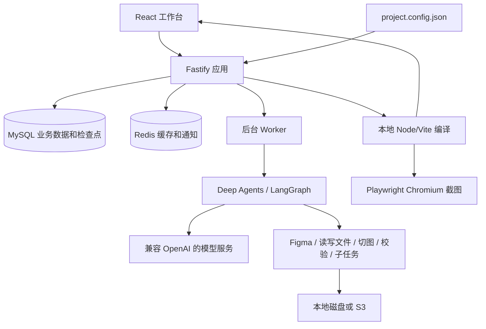

# 架构与存储

## 一次生成

1. 用户登录，创建个人或团队工作区，复制固定版本 Skill 与配置。
2. 创建会话、保存 Figma Token、提交消息；消息与执行记录先进入 MySQL。
3. Worker 领取执行租约并续租，读取检查点和会话资源后调用 Agent。
4. Agent 调用注册工具；图片、文件和执行记录持续保存，通过 SSE 向页面传递更新。
5. 暂停或异常后保留已保存内容；继续时从可用检查点恢复，外部操作仍需校验已有文件以避免重复写入。
6. 暂存版本异步冻结文件、打包上传，完成后在作品库查看或下载。
7. 在线编辑基于临时副本，保存后增量编译并刷新预览，用户可以将修改应用回会话工作文件。

## 文件关系

| 目录 | 内容 |
| --- | --- |
| src/index.ts | 启动入口、监听端口与关闭信号 |
| src/app.ts | 初始化通用工具、HTTP Hook、登录、接口、静态资源和预览 |
| src/config | 项目配置和业务运行参数契约 |
| src/hooks/tools | MySQL、Redis、日志、存储和凭据加密适配 |
| src/hooks/http | 本地登录身份、守卫和访问日志 |
| src/functions/d2c | 工作区、会话、后台执行、预览、编辑与版本业务 |
| src/models | Sequelize 模型及 LangGraph 检查点模型 |
| src/functions/d2c/run | Agent 运行时、模型连接、工具和执行调度 |
| web | React 工作台与 Monaco 编辑器 |
| pixelprint | 从公开上游同步的固定 Skill、脚本和模板 |
| preview-template | H5 / RN Web 预览模板和本地编译器 |
| preview-browser | Chromium 截图工具 |
| image-compression | Python 图片处理依赖与脚本 |
| scripts | 初始化、依赖准备、数据库建表与更新命令 |

## 数据位置

- MySQL：工作区、团队、会话、消息、文件修订、执行、时间线、版本和检查点等持久数据。
- Redis：缓存、通知和并发协调；不是唯一聊天历史来源。
- `.data/files` 或 S3：图片、归档和资源对象；数据库保存内容或对象引用及修订关系。
- `.runtime`：单轮临时执行目录、预览缓存和编辑副本，不能取代持久数据。
- `project.config.json`：模型密钥、数据库配置、登录账号和加密密钥，仅服务器可读。

本发行版没有远程 Sandbox 服务，也没有预览内部的 Docker 执行器。提供的 Dockerfile / Compose 用于部署整个应用，和预览引擎是两回事。浏览器 iframe 的 sandbox 属性仍保留。

## 执行边界与恢复

LangGraph 的节点调度预算与模型请求次数分别控制。每段图允许 2048 步；遇到原生图步数异常时，先核对检查点、授权文件与最新规则检查。交付完整且不存在未配对工具或等待用户回答时直接收取结果。

存在检查点且有持久文件或报告进展时，向同一图传入 null 继续，单次执行最多自动续作两段，不重新追加用户消息。无进展或达到恢复次数时，子任务返回未完成项和原任务标识，由主 Agent 接管或恢复原子任务。模型请求预算、取消、租约及存储故障处理不因此放宽。

## 生成期间的预览

源码可能先于样式保存。任务仍在排队或执行，且本次构建明确缺少尚未保存的同目录源码或样式时，界面显示“等待文件保存”，保留上一份成功预览；保存新修订后沿用文件变更通知更新预览。

这只是前端状态投影，数据库仍保留真实构建诊断。任务结束或暂停后恢复缺文件错误；缺少第三方包、语法错误、越界路径和版本预览不会进入等待状态。

## 生成效率与局部修改

每次模型请求在执行诊断中展示总耗时、请求开始到首个有效输出的耗时、首个输出到结束的耗时，以及服务返回的请求编号。主任务、子任务和摘要共用计时入口；失败或取消也保留已测阶段。旧记录或没有首块时显示未知，首块耗时不能直接解释为网关内部排队时间。

生成前由固定配置和已有入口构造主、子 Agent 共用的目录及合并约定。新页面的区块目录位于页面目录内；后续修改保留现有目录与组件组织，避免因默认模式反复搬迁。自定义入口和多个页面沿用已有事实，用户明确要求优先。该约定引导模型，实际权限仍由文件工具控制。

已有源码可以使用 `edit_file` 局部修改：先通过 `read_file` 取得原文件摘要，再提交唯一匹配的旧片段、新片段和摘要。摘要过期或片段不唯一时不写入，返回可纠正反馈；新文件继续使用 `write_file`。编辑与完整保存共享权限、修订及检查逻辑，UI 子任务只能修改精确授权的文件。UTF-8 BOM 保留；编辑回执中断后保留符合条件的原子任务上下文，但工具结果仍为未知，恢复后须核对并重新检查，不自动重放。

以上改动减少重复输出并提供定位依据，实际生成耗时及模型遵循程度仍需用真实任务对比，不承诺固定提速比例。

## Figma 脚本失败与工具纠错

固定 `figma.mjs` 返回完整失败 JSON 时，即使退出码为 1，运行层也会解析并分类；已有工作区的固定脚本副本可以直接使用此能力。

| 失败原因 | 处理 |
| --- | --- |
| 本次节点不存在，或未返回该节点的图片地址 | 返回可调整反馈，Agent 核对根节点缓存、真实节点和切图清单后继续 |
| 请求参数无效 | 返回参数反馈，允许 Agent 调整后再调用 |
| 临时连接故障、服务端错误或短时限流 | 沿用已有工具重试预算和等待时间，不新增一层自动重放 |
| 凭据或权限不足、资源拒绝访问、等待时间过长 | 提示用户处理并保留当前产物 |
| 无效 JSON、响应超限、未授权主机、文件系统或未知异常 | 记录失败诊断并结束本轮 |

服务端失败日志可通过 `errorId` 和 `runId` 关联，增加 `scriptReason`、`scriptPhase`、节点编号、退出码、可信 HTTP 状态及已知网络码。网络前置区分请求、响应和读取正文阶段，正文解析失败仍保留限流等待时间。原始输出、错误正文、Token 和完整请求地址不会直接上报。

旧脚本错误字符串只匹配本次节点对应的完整固定模板；任意正文中的状态码或网络词不触发重试。取消、租约失效、脚本超时和进程输出限额优先于可纠正反馈。离线测试覆盖真实 Node 子进程和纠错后的继续执行，真实 Figma 连通性仍须在部署环境验证。
