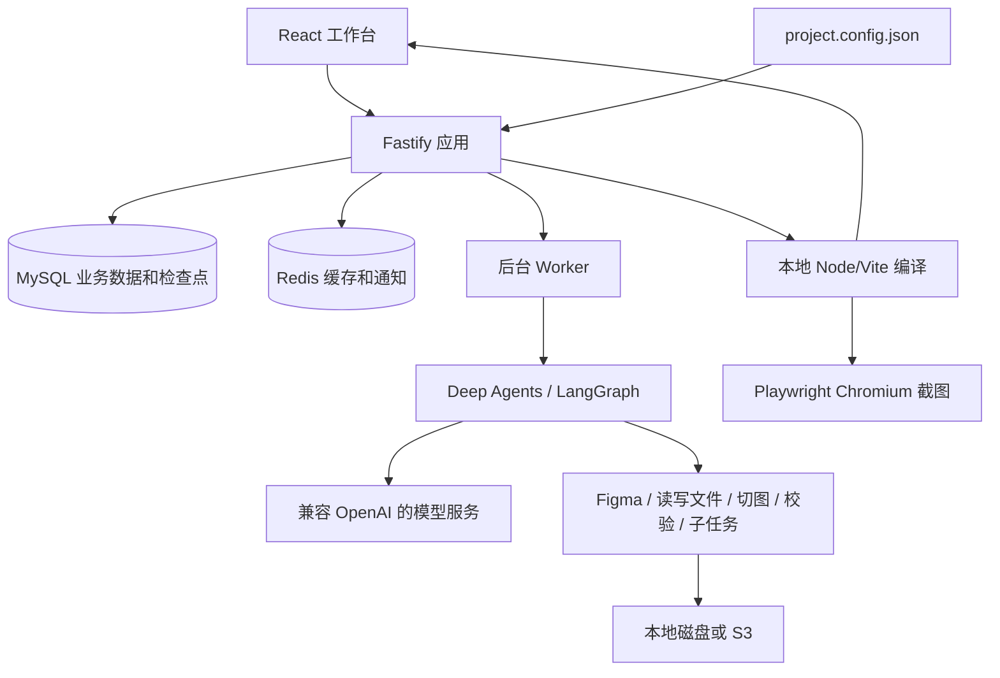

# 架构与存储

## 一次生成

1. 用户登录，创建个人或团队工作区，复制固定版本 Skill 与配置。
2. 创建会话、保存 Figma Token、提交消息；消息与执行记录先进入 MySQL。
3. Worker 领取执行租约并续租，读取检查点和会话资源后调用 Agent。
4. Agent 调用注册工具；图片、文件和执行记录持续保存，通过 SSE 向页面传递更新。
5. 暂停或异常后保留已保存内容；继续时从可用检查点恢复，外部操作仍需校验已有文件以避免重复写入。
6. 暂存版本异步冻结文件、打包上传，完成后在作品库查看或下载。
7. 在线编辑基于临时副本，保存后增量编译并刷新预览，用户可以将修改应用回会话工作文件。

## 文件关系

| 目录 | 内容 |
| --- | --- |
| src/index.ts | 启动入口、监听端口与关闭信号 |
| src/app.ts | 初始化通用工具、HTTP Hook、登录、接口、静态资源和预览 |
| src/config | 项目配置和业务运行参数契约 |
| src/hooks/tools | MySQL、Redis、日志、存储和凭据加密适配 |
| src/hooks/http | 本地登录身份、守卫和访问日志 |
| src/functions/d2c | 工作区、会话、后台执行、预览、编辑与版本业务 |
| src/models | Sequelize 模型及 LangGraph 检查点模型 |
| src/functions/d2c/run | Agent 运行时、模型连接、工具和执行调度 |
| web | React 工作台与 Monaco 编辑器 |
| pixelprint | 从公开上游同步的固定 Skill、脚本和模板 |
| preview-template | H5 / RN Web 预览模板和本地编译器 |
| preview-browser | Chromium 截图工具 |
| image-compression | Python 图片处理依赖与脚本 |
| scripts | 初始化、依赖准备、数据库建表与更新命令 |

## 数据位置

- MySQL：工作区、团队、会话、消息、文件修订、执行、时间线、版本和检查点等持久数据。
- Redis：缓存、通知和并发协调；不是唯一聊天历史来源。
- `.data/files` 或 S3：图片、归档和资源对象；数据库保存内容或对象引用及修订关系。
- `.runtime`：单轮临时执行目录、预览缓存和编辑副本，不能取代持久数据。
- `project.config.json`：模型密钥、数据库配置、登录账号和加密密钥，仅服务器可读。

本发行版没有远程 Sandbox 服务，也没有预览内部的 Docker 执行器。提供的 Dockerfile / Compose 用于部署整个应用，和预览引擎是两回事。浏览器 iframe 的 sandbox 属性仍保留。
