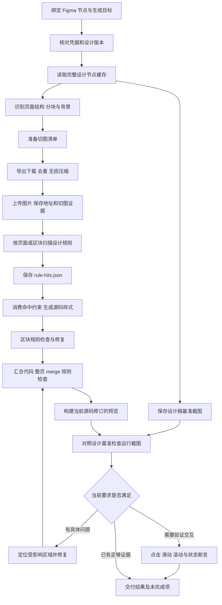
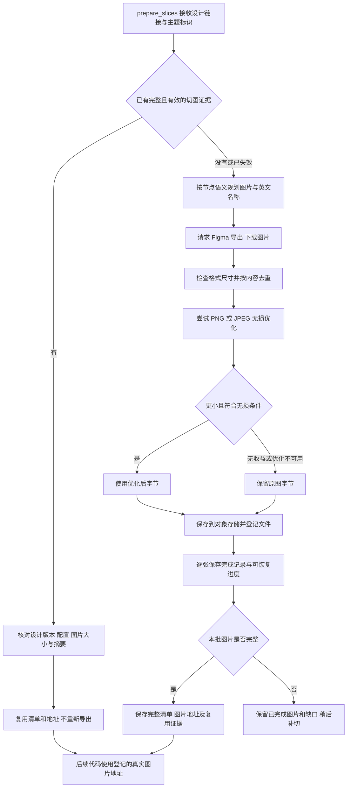
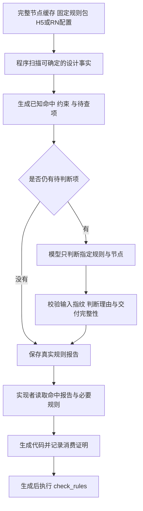
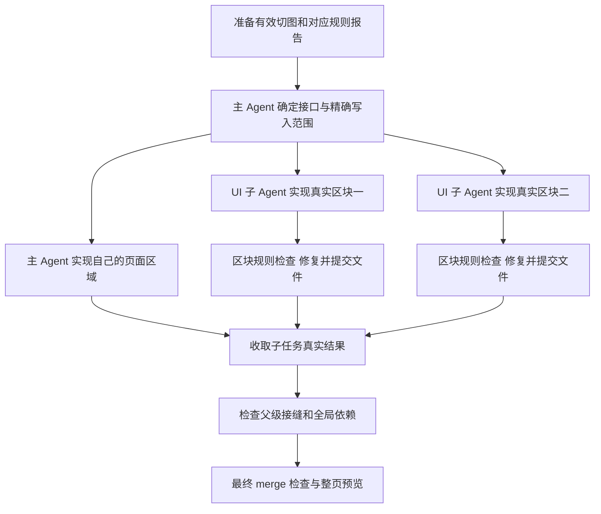
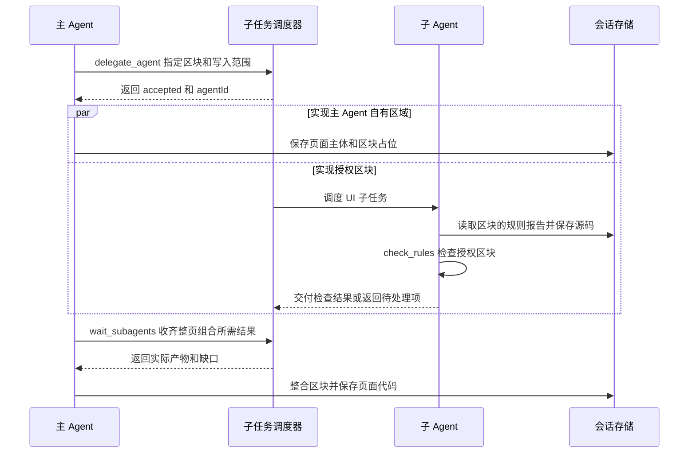
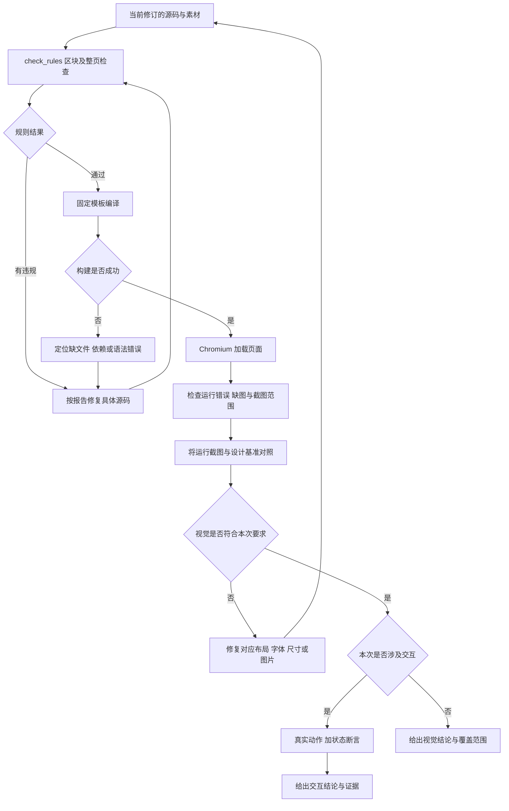
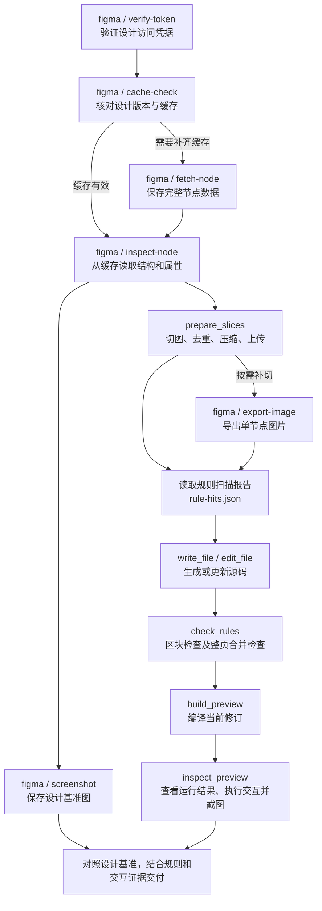
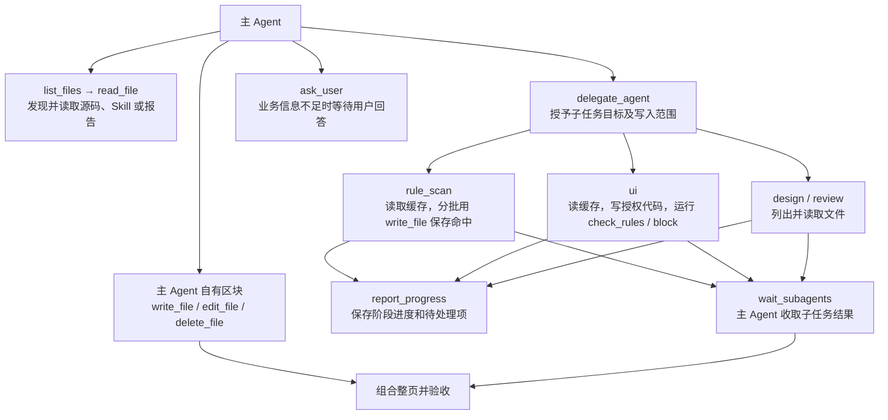

# D2C 生成与验收流程

本文说明“设计稿如何变成页面，以及凭什么判断结果可用”。架构组件与数据存放见[架构与流程图](架构与流程图.md)，具体操作见[使用指南](使用指南.md)。

流程依据当前平台能力与工作区固定的 Skill/规则版本。已有工作区可能绑定旧资源；会话中的实际记录才是本次执行证据。

## 1. 先看完整路径

这是首次生成的依赖关系，不是每次修改都完整重跑一遍。设计基准采集与素材准备的具体先后可按依赖安排，但首次出码前要有可用设计基准、切图依据和对应规则报告。界面出现“运行完成”不等于图中的所有验收都已通过。

## 2. 设计读取：先建立同一份事实

1. 解析设计链接中的文件与节点，核对本人凭据、目标 H5/RN 和固定资源版本。
2. 核对设计版本，读取或恢复完整根节点缓存。截断的浅层结果不能当完整设计。
3. 主 Agent 识别页面结构、背景、真实 `sub-` 区块及输出目录，建立执行清单。
4. 保存会话绑定根节点的设计基准截图，供后续视觉对照。

**结构读取**回答“页面有哪些区域”；**规则扫描**回答“这些节点需要遵守哪些生成约束”。两者可以读取同一缓存，不应各自重新从 Figma 拉取整份数据。规则或尺寸信息不足时再定点补读。

没有 `sub-` 的页面也要对页面根做设计规则扫描。小区块内联、同构区块复用及其他例外以固定 Skill 为准，不能因为页面简单就省略必要证据。

## 3. 切图、压缩和上传如何衔接

- 前置切图由服务端 `prepare_slices` 完成；需要导出的节点由切图契约、命名和设计事实决定，不把整页直接切成一张图来代替布局实现。
- 当前前置 PNG 导出使用 2 倍比例。无损优化不改变像素、尺寸或格式，也不承诺每张图片一定变小；接近 1MiB 的图片可能已经优化过。
- 相同内容或同构列表可以共享图片。名称使用英文语义，同批重名消歧；跨主题对应位置尽量继承同名，每个主题的上层目录独立，同一页面/主题保持目录一致。
- 图片上传成功、存储登记成功、清单完整是不同条件。进度显示“23/23”之后仍可能在保存和核验；计数本身不代表整个工具已成功返回。
- 中途失败保留已完成图片和进度。继续时核对有效证据再补缺口；设计版本、配置或真实图片发生变化时不能盲目复用。

图片地址来自当前配置的本地文件服务或 S3 兼容存储。浏览器需要能访问公开素材地址；服务端恢复及预览输入还会核对登记的字节与摘要。不要把私有正文存储地址作为公开图片链接。

## 4. rule-hits.json：出码前的规则作业单

这里实际使用的文件名是 **`rule-hits.json`**，不是独立的 `hit.json`。它连接设计扫描和代码生成。

| 报告内容 | 用途 | 不能代表什么 |
| --- | --- | --- |
| `hits` | 记录规则、真实节点及触发依据，指导生成 | 不能证明源码已经符合规则 |
| `constraints` | 提供布局、单位、颜色等实现约束 | 不能替代最终代码检查 |
| `deferredChecks` | 标明必须等有源码后再验证的项目 | 待检查不是通过 |
| `nativeScan` | 记录输入指纹、程序覆盖和待模型判断项 | 不自动认证未知规则 |
| `nativeReview` | 保存疑难项的判断与理由 | 口头完成不能代替完整交付 |

真实区块通常保存到 `blocks/<区块>/rule-hits.json`；无分块页面保存到页面目录。具体以工具分配的真实路径为准。`assets.txt` 还会记录图片使用、规则消费等说明。

程序扫描使用已审阅规则的算法；复杂语义、规则变化及未支持项目仍需模型处理。报告指纹包含目标、设计事实、配置和规则，输入变化后旧判断可能失效。H5/RN 有各自适配，不把未知技术栈自动当作 H5。

## 5. 代码生成怎样分工

主 Agent 不需要从委派起一直空等，可先实现自己的区域，并为子区块保留接口或占位。当前最多两个互斥子任务同时执行；是否分块及实际调度取决于设计、固定 Skill 和模型决策。最终组合、全局检查和预览必须等所需子产物汇合。

UI 子任务只能写授权文件；规则扫描任务只交付授权规则报告。子任务完成后要核对实际文件与检查结果，`accepted` 仅表示已接单。局部失败可把已有文件、报告和缺口交回主任务，不能用空报告伪造扫描成功。

### 委派、并行实现与收取结果

主 Agent 在整合前可通过 `mode=any` 先收取已完成项。图中展示的是组合整页时收齐结果的情况。

## 6. 验收流程：几种检查分别回答什么

构建和规则检查在执行中可交错发生，文件保存后也可能自动构建；上图表达最终证据之间的关系。规则通过不需要被误读成其他检查通过。

| 检查 | 主要依据 | 通过之后仍不能保证 |
| --- | --- | --- |
| 设计规则扫描 | 设计事实、固定规则和疑难项判断 | 生成代码正确 |
| 代码规则检查 | 实际源码、命中报告、素材和检查配置 | 浏览器运行、视觉与业务行为正确 |
| 编译 | 当前入口及依赖能构建 | 页面没有缺图、布局正确 |
| 运行截图 | 真实页面加载、错误与图片检查 | 与设计稿一致、点击有效 |
| 视觉对比 | 模型实际收到的设计图与运行图、目标区域 | 未覆盖区域和全部业务状态正确 |
| 交互验收 | 点击/滑动/滚动及动作前后状态 | 未执行场景或 RN 原生端正确 |

截图对比由 Agent 结合真实图像和设计属性判断，当前不应被描述为固定阈值的自动像素差分评分。图片读取失败、模型未收到图或截图只覆盖局部时，不能声称整页视觉通过。

规则结果绑定实际源码修订。检查后又改了源码，旧通过记录需要重新核对；页面可能显示“待检查”。一次执行正常结束与规则通过是两种状态。

### 截图覆盖与真实交互

- 运行截图保留 **12,000px / 10MiB** 限制，以约束长页面的资源消耗；页面本身不会被裁短。
- 超长页面可以定位底部或目标区块。覆盖信息区分高度、字节上限和内部滚动；局部图不能证明整页通过。
- 点击需实际点击目标；滑动需真实触摸或鼠标手势；循环需观察双向重复操作、状态变化及回环。
- 单次受控计划最多 12 个动作，不开放任意脚本。截图和断言以指定源码修订、入口和动作计划为准，不混用旧图。

## 7. 后续修改、修复与继续

| 本次要求 | 优先复用 | 主要新增工作 |
| --- | --- | --- |
| 首次生成或结构重做 | 有效固定资源与设计缓存 | 完整设计依据、规则扫描、生成及对应验收 |
| 只替换图片和颜色 | 结构、交互、有效报告及基线命名 | 主题图片映射、颜色来源、缺图与构建/必要预览 |
| 增加点击、滑动或循环 | 当前源码、图片和有效设计信息 | 定点修改与动作/状态验收 |
| 用户要求整页重验 | 已有文件和可核实证据 | 当前修订的完整对应检查 |
| 暂停后继续 | 检查点、已保存文件和有效交付 | 复查范围，接续未完成项 |

已有页面的交互增量默认一轮验收加最多两次复验，通过即交付；达到预算或无法获得真实证据时说明未完成项并保留进度。该上限不是首次生成的统一截图次数。首次生成的修复按既定批次补入截图，并受总预算与无进展保护约束。

网络暂时失败可按既定策略重试；凭据、配置、存储、失租及取消等问题不能一概吞掉后继续。恢复先核对真实落盘与输入版本，既不能丢弃已有成果重做，也不能拿过期证据跳过必要步骤。

## 8. 想排查“卡在哪一步”时看什么

| 界面或资料 | 说明 |
| --- | --- |
| 当前阶段、助手回复和工具过程 | 当前在读取设计、切图、扫描、实现还是验收 |
| `slice-manifest-<主题>.json` | 图片节点到文件的清单、完成情况、尺寸告警与压缩统计 |
| `asset-urls.json` | 已登记图片与实际访问地址 |
| `slice-evidence-<主题>.json` | 供系统核实切图复用的证据 |
| `rule-hits.json` | 出码前的设计规则命中与约束 |
| `assets.txt` | 实现者记录的素材使用与规则消费说明 |
| 代码规则检查报告 | 当前检查的违规、跳过项与结果 |
| 设计基准图、运行截图与动作结果 | 视觉与交互的实际观察依据 |
| 执行诊断 | 模型与工具耗时、用量、错误次数、排查编号与 runId |

这些资料由工具维护，不能通过手改内部证据把失败变成通过。对普通使用者，更实用的反馈是“哪一个元素、预期怎样、实际怎样、对应截图与会话”，而不是自行编辑缓存文件。

## 9. 工具调用图

### 设计读取到代码验收

图中是首次生成的主要调用关系。缓存可用时可直接读取，补切和业务提问按需发生。

### 主 Agent 和子任务怎样用工具

子任务调用 `figma` 时只能通过 `inspect-node` 读取会话绑定稿的已有缓存。主 Agent 负责切图和运行预览。完整命令说明和权限见 [D2C Agent 工具参考](reference/D2C工具参考.md)。
