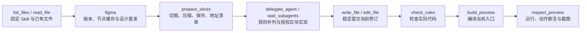

# D2C Agent 工具参考

这些工具由后台 Agent 调用。用户可在会话的执行过程或子任务记录中看到工具名称、阶段和结果。具体工具取决于当前任务角色及服务装配。

| 工具 | 作用与结果 |
| --- | --- |
| `list_files` | 列出会话文件。传入 `resource=true` 可列出工作区固定资源目录，先用它查找规则文件的完整名称。 |
| `read_file` | 读取文本或受支持的图片。长文本按返回的 `nextOffset` 继续读。用 `resource=true` 读取固定 Skill。 |
| `write_file` | 保存源码或授权的报告。规则扫描任务可分批合并命中和判断结果。 |
| `edit_file` | 精确替换文件中的一段文本，校验文件摘要和匹配唯一性。冲突后需重读当前文件。 |
| `delete_file` | 删除允许删除的源码。图片和固定资源受到保护。 |
| `figma` | 验证凭据、读取设计节点、检查缓存、补切单图或获取设计稿截图。具体命令见下表。 |
| `prepare_slices` | 校验并复用已有切图，或按页面及主题组织导出、下载、去重、无损压缩和上传，返回清单及地址索引。 |
| `check_rules` | 检查实际代码。主 Agent 可对区块运行 `block`，也可对整页运行 `merge`。UI 子任务仅能检查授权区块。 |
| `delegate_agent` | 委派设计分析、审查、规则扫描或 UI 实现，指定目标和写入范围。接单回执可用于后续收取结果。 |
| `wait_subagents` | 收取任一或全部指定子任务的结果。整页组合、预览及交付前收齐所需结果。 |
| `report_progress` | 子任务保存已完成项、待处理项和下一步，便于恢复。完成仍以产物和检查结果为准。 |
| `ask_user` | 向用户提业务问题，将回答交回对应执行步骤。 |
| `build_preview` | 用当前会话源码和指定入口构建预览，返回构建状态及编译诊断。 |
| `inspect_preview` | 打开运行预览，检查页面错误及缺图，按需点击、滑动、滚动和断言，再返回截图与观测结果。 |

## Figma 命令

| 命令 | 作用 |
| --- | --- |
| `verify-token` | 验证配置的 Figma 凭据。 |
| `cache-check` | 核对设计版本和现有缓存，供后续步骤决定能否复用。 |
| `fetch-node` | 获取设计节点并保存缓存。页面规则扫描需要完整根节点数据。 |
| `inspect-node` | 读取已有节点缓存中的真实属性和子节点。可浅读或分页读取子树。 |
| `export-image` | 导出单个节点图片，适合定点补切。批量准备走 `prepare_slices`。 |
| `screenshot` | 获取设计稿截图作为视觉基准。运行页面的截图来自 `inspect_preview`。 |

## 子任务权限

- `design`、`review` 可列出和读取文件，并保存进度。
- `rule_scan` 还可读取绑定稿的节点缓存，向授权的 `rule-hits.json` 分批写入规则判断。
- `ui` 还可读取节点缓存，写入或修改授权区块文件，并执行区块规则检查。
- 子任务使用 `figma` 时只开放对绑定稿已有缓存的 `inspect-node`。委派、切图和运行预览由主 Agent 负责。

生成前的规则扫描为出码提供 `rule-hits.json`，生成后的 `check_rules` 检查当前源码。生成、检查与交付的关系见 [D2C 生成与验收流程](../D2C生成与验收流程.md)。

## 典型调用顺序

这是典型依赖关系；主任务可以与已委派区块并行工作，已有有效节点与切图优先复用。小范围交互修改直接读取目标源码，保存后验收，不必重新走完整设计扫描和切图。

## 参数、结果与失败处理

| 工具或场景 | 调用要点 | 失败后的处理 |
| --- | --- | --- |
| 固定规则读取 | `list_files` 配合 `resource=true` 获取真实文件名，再用 `read_file` 读取 | 不猜测 `R01.md` 等缩写，不用文件读取接口枚举目录 |
| 长文件读取 | 按工具返回的截断标志和 `nextOffset` 补读；偏移是字符位置 | 大模型窗口不取消单次工具的大小限制；不重复读取相同范围 |
| 精确编辑 | 使用当前文件摘要与唯一匹配内容 | 冲突时重读最新修订，不能覆盖其他任务已提交结果 |
| 区块委派 | 指定任务目标、负责节点和精确写入范围 | 先读取已保存进度和产物，恢复缺失部分；已完成区块不重做 |
| `inspect_preview` | 使用 `entryPath`、可选 `actions`、`focusSelector`；动作支持 click/swipe/scroll/expect | 参数错误按工具反馈修正；断言失败记录实际观测，不当作交互通过 |
| 截图覆盖 | 定点截图可检查长页面下部；页面截图有 12000px / 10MiB 上限 | 局部覆盖不等同整页验收，按实际 coverage 说明未覆盖范围 |
| 存储与租约 | 文件和事件经过服务端受保护提交 | 关联排查编号与 runId 查询诊断，不把上传完成等同数据库登记完成 |

具体参数校验以工具定义为准，入口为 `src/functions/d2c/run/agent/agent.ts`、`run/tools.ts` 和 `preview/inspection.ts`。公开聊天与工具摘要是用户可读投影，完整检查点、原始响应及凭据不直接显示。

## 自建部署使用的基础工具

下表是应用的基础设施连接，不是模型可随意调用的 Agent 工具。

| 能力 | 当前实现 | 配置入口 / 代码 |
| --- | --- | --- |
| HTTP 与页面 | Fastify、React、Ant Design | `server`；`src/app.ts`、`web/src/` |
| 账号与登录态 | 本地账号、scrypt 密码哈希、签名 Cookie；个人 API Token 用于插件接口 | `auth`；`src/hooks/http/identity.ts`、`auth.ts` |
| 数据库 | MySQL、mysql2、Sequelize | `database`；`src/hooks/tools/mysql.ts` |
| 缓存与通知 | 标准 Redis / node-redis；编辑副本、Pub/Sub 通知 | `redis`；`src/hooks/tools/redis.ts` |
| 结构化日志 | Pino；诊断字段脱敏并关联排查编号 | `logging`；`src/hooks/tools/logging.ts` |
| 文件与对象 | 本地文件或 S3 兼容对象存储（例如自建 MinIO、AWS S3） | `storage`；`src/hooks/tools/storage.ts` |
| 模型 | 兼容 OpenAI 的模型接口、Deep Agents / LangGraph | `runtime.modelConfigs`；`run/agent/model.ts` |
| 编译与截图 | 固定 Vite 模板、本地 Node 子进程、Playwright/Chromium | `npm run prepare:preview`；`preview-template/`、`preview-browser/` |
| 图片压缩 | 固定图片处理工具链，尝试无损优化并保存真实结果 | `npm run prepare:images`；`scripts/prepare-image-compression.mjs` |
| 运行配置 | 启动时读取项目配置文件，修改后重启 | `project.config.json` 或 `PIXELPRINT_CONFIG` |

部署步骤见[部署与配置](../deployment/部署与配置.md)，字段见[配置说明](../deployment/configuration.md)，建表和升级统一见[SQL 入口](../sql/README.md)。
