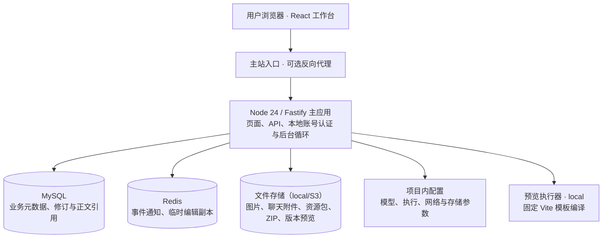
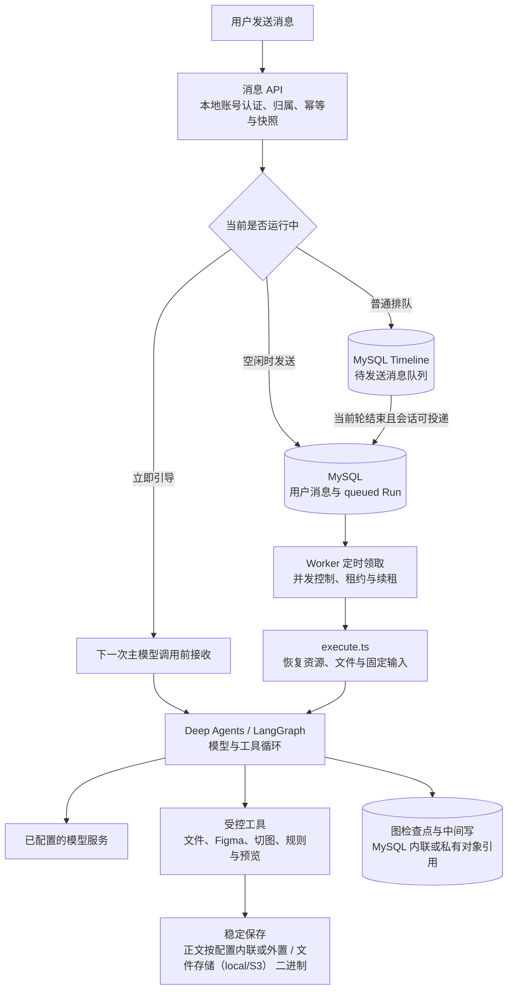
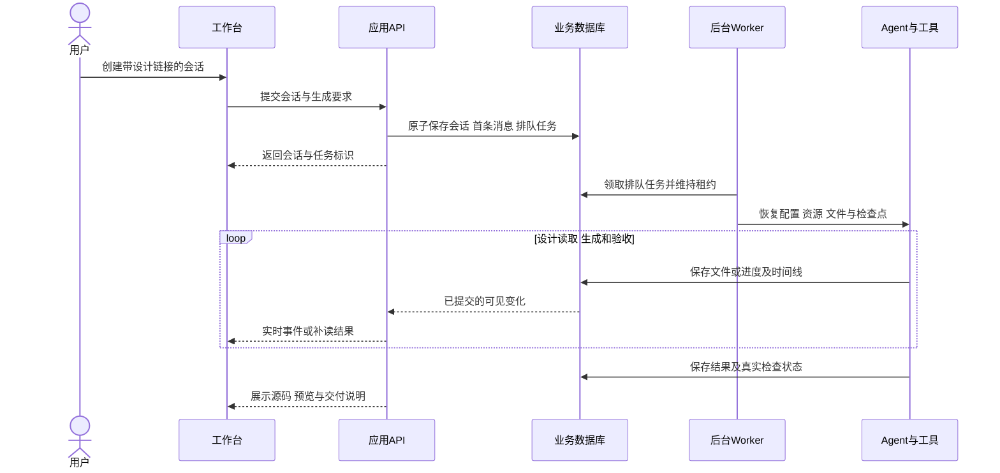
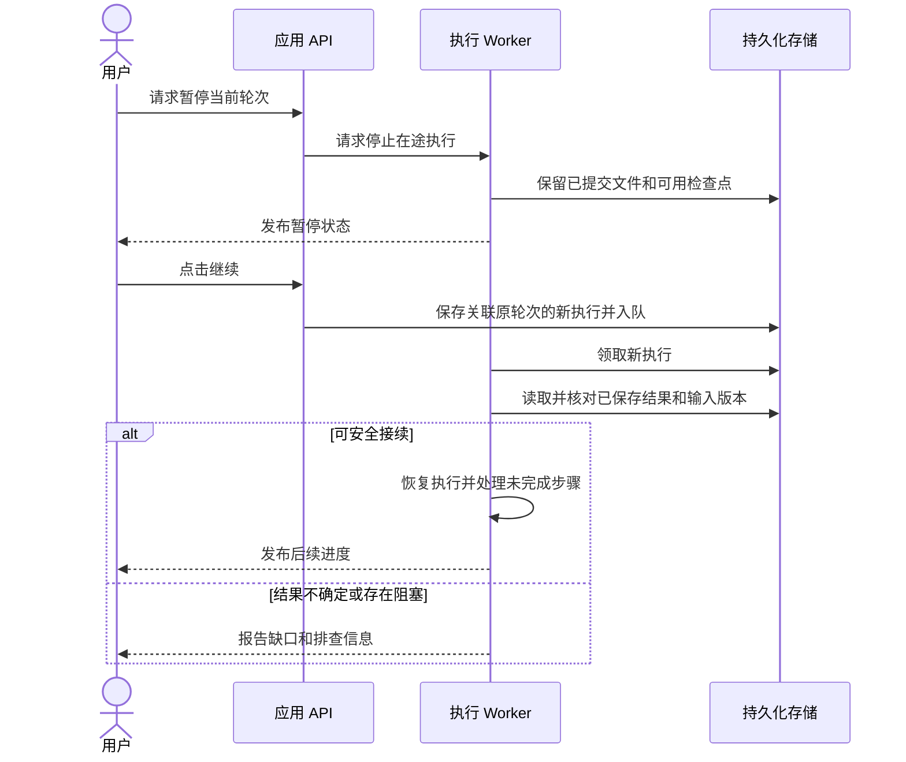
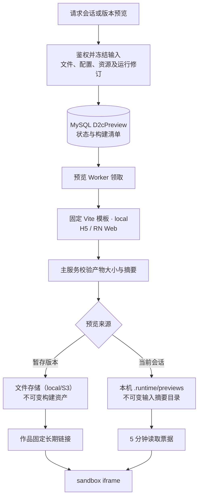
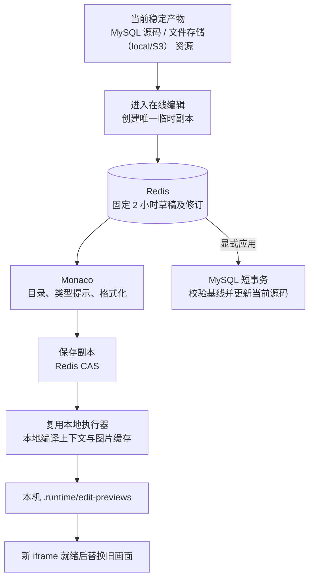
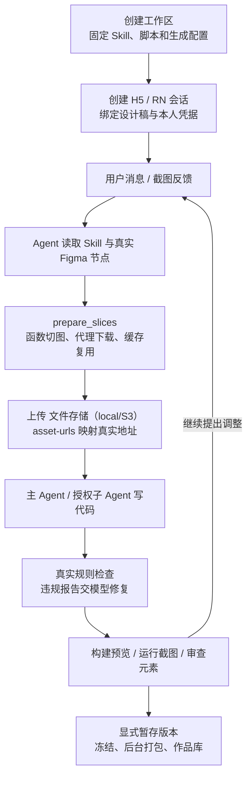
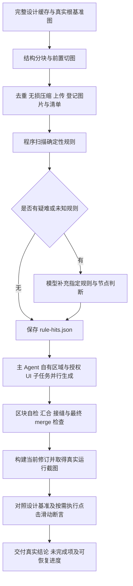
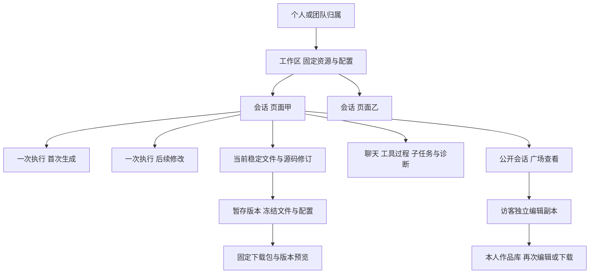
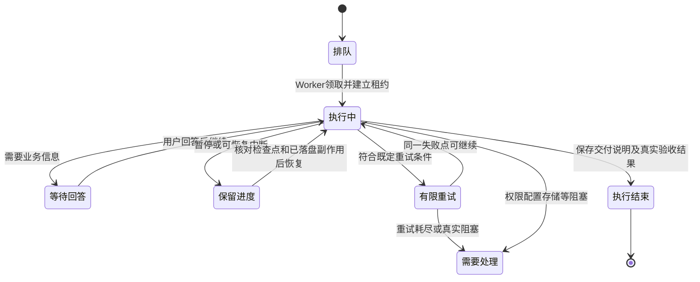

# 架构与流程图

核对日期：2026-11-24。保留原章节和详细数据流，按当前存储、扫描及验收能力修正；不代表目标环境已完成发布验收。本文按当前代码说明部署、执行、预览和在线编辑。各图按职责分开阅读，箭头表示调用或数据流；具体参数以实现及知识专题为准。汇报口径见[系统能力清单](系统能力清单.md)，阅读导航见[文档目录](README.md)。

## 1. 部署：一个主应用，本地预览执行

- `src/index.ts` 创建 Fastify 并按 `project.config.json` 的 `server.host/port` 监听；`npm run build` 构建，`npm start` 启动，Compose 也可部署整个应用。
- `/api/d2c/*` 提供工作区业务，`/assets/*` 与页面来自 `dist/public`；`/H5_Preview/*`、`/RN_Preview/*` 是专用票据资源路由，失败不会回落到主站页面。
- Agent Worker、版本打包恢复循环、预览 Worker 是服务中的后台代码；它们有各自的队列/状态与期限。预览默认由本地 Node/Chromium 子进程编译和截图，编译及截图使用本地执行链。
- 预览使用固定模板与锁定依赖，子进程环境不传递模型、数据库和上传密钥；保留超时、取消、进程组回收及输入范围校验。编译与主服务共享机器资源和服务账号权限；浏览器 iframe sandbox 与 CSP 保留。
- 浏览器通过同域票据路径加载生成页面，iframe 与响应 CSP 均采用 `sandbox allow-scripts`，不授予 `allow-same-origin`，形成 opaque origin 隔离。浏览器中的生成代码与主站业务代码分开运行。

## 2. Agent：先保存消息，再由 Worker 执行

### 2.1 一条消息的调用顺序

1. 空闲发送由 `session/messages.ts` 在事务中检查用户归属、幂等请求及配置，保存用户消息、Run、无密钥模型/生成配置快照和时间线。运行中普通发送由 `session/queue.ts` 持久排队；选择立即发送时转为当前轮的引导，在下次主模型调用前接收，在途工具先完成。
2. `run/worker.ts` 按 `pollIntervalMs` 扫描 MySQL 并领取任务。`concurrency`限制本地空槽及数据库全局准入；同一会话由活动轮次和事务约束避免重叠写入。
3. `run/leases.ts` 管领取、续租与受保护提交。`run/execute.ts` 在 `execution.workRoot` 下恢复本轮资源和工作文件，构建工具与持久化回调，协调心跳、取消及终态。
4. `run/agent/run.ts` 接入历史、模型和 MySQL Saver；`run/agent/agent.ts` 运行 Deep Agents。模型选择工具，平台实际执行工具函数，再将结果交回框架循环。
5. 主 Agent 可显式委派 `design`、`review`、`rule_scan`、`ui`。子 Agent 是同一 Run 内的独立模型上下文，最多两个并行，使用共享总预算、取消和租约；不另建顶层 Run。
6. `design/review` 只读；`rule_scan/ui` 按精确文件授权写入。UI 校验仅限负责的区块，写后旧检查失效；主 Agent 负责自有区域、组合和最终机械 merge。未含 `sub-` 的整页生成由主 Agent 负责，具体微区块策略服从工作区固定 Skill。
7. 规则不通过时保留报告和产物校验状态；工具与存储正常完成的 Run 可为 `succeeded`。网络、工具或存储异常按真实分类处理，不能把“执行完成”解释为代码已通过规则或视觉验收。

D2C Worker 使用 MySQL 持久任务队列；Redis 提供时间线通知和编辑副本。运行中普通消息先排队，下一次主模型请求才接收即时引导，等待输入或中断时保留待发送内容。

### 2.2 执行过程怎样回到页面

创建会话时填写设计链接，应用会在同一事务中保存会话、首条生成消息和排队任务。后台领取后，工作台按时间线展示已保存的进度。未填写设计链接的会话可等用户发消息后再开始。

事务先提交 Timeline 的会话内递增 `seq`，再通过本地通知与 Redis Pub/Sub 提示 SSE 读取新事件。通知只带定位信息，事件正文以 MySQL 为准。SSE 按游标补读，空闲每 15 秒兜底查询，心跳与补读分别处理；浏览器断线不停止后台 Run。

主模型公开文字、工具摘要、文件变化、业务提问和执行状态进入时间线。界面按 Run 归组，重点显示回复，执行过程可展开并在结束后收起；工具开始/结束按调用 ID 配对，并显示文件路径、命令等安全摘要。完整框架状态、内部归档与凭据保持私有。子会话抽屉展示脱敏任务、可见回复与工具过程，执行诊断展示有真实记录的耗时与用量，未报告值保持未知。

### 2.3 提问、停止与继续

| 操作 | 后端行为 | 保留内容 |
| --- | --- | --- |
| Agent 提问 | LangGraph `interrupt` 保存问题及中断检查点，Run 进入 `waiting_input`，释放执行名额 | 固定输入、已保存文件、历史与累计用量 |
| 用户回答 | 事务保存回答，将同一个 Run 重新排队，用 `Command` 从对应中断恢复 | 同一 `thread_id` 和问题上下文 |
| 用户停止 / 超时 | 停止实际执行，保留稳定状态；超时结算为可继续的中断 | 已提交文件与事件，未提交内容不保证保留 |
| 显式继续暂停或中断 | 创建关联原轮次的新 Run，核对输入后恢复稳定历史和文件 | 不自动重放结果未知的副作用 |
| 关闭浏览器 | 只断开浏览器订阅 | 后台仍运行，重新打开按游标读取 |
| 进程丢失 | 租约过期后按恢复策略标记中断 | 以持久化数据为恢复依据 |

### 暂停后怎样继续

此图对应用户显式暂停后继续。业务提问后的回复使用原轮次保存的问题上下文接续。

## 3. 普通运行预览：冻结输入后按批次编译

完整分支图见[预览执行逻辑](预览执行逻辑.md)，涵盖本地执行器、缓存命中、在线编辑和 Agent 截图反馈。

- 当前会话按文件集修订和输入 hash 判定缓存，目录为 `.runtime/previews/sessions/<sessionId>/<entryHash>/<inputHash>/`；完整命中直接打开，票据更新不触发重新编译。
- 版本预览读取冻结的 `D2cVersionFile`，成功后逐文件上传 文件存储（local/S3） 并保存构建清单；不会因当前会话继续修改而改变历史版本。
- 预览 Worker 的领取、续租与恢复由预览服务处理，和 Agent 的 Run 租约分别管理。当前固定构建期限120秒，会话/编辑读取票据300秒，作品版本链接长期有效；由代码常量控制，旧 `d2c.preview` 字段仅保留结构兼容校验。
- H5 使用可信 PostCSS px2vw 插件，转换基准取固定生成配置；RN 使用 React Native Web 与受控 rpx/helper、静态图片引用适配，不执行 H5 px2vw。
- 手机视口、缩放和全屏切换只改变展示，不重新编译或重签票据；当前组件保持同一 iframe。新源码构建或读取失败保留原源码、对话与已暂存版本。
- 主Agent可调用build_preview/inspect_preview，将真实构建和运行截图反馈纳入当前循环；稳定源码变化合并800ms请求预览，真实运行截图经 文件存储（local/S3） 上传后登记为 MySQL 消息附件，并在聊天中显示、支持后续模型读取；同一预览及归一动作/聚焦参数一致时复用已保存图片。截图受图片大小等限额约束，截图成功仍需独立规则与视觉验收。
- “审查元素”由可信 nonce 脚本和受约束 `postMessage` 协议提供 DOM 类名与样式查看。它不等于浏览器完整开发者工具，也不授权修改源码。

## 4. 在线编辑：临时副本保存与显式应用

1. 每次进入都以当前稳定产物新建副本，替换之前的临时副本；仅支持已有可编辑源码，不把 Skill、内部缓存或二进制当作代码编辑。
2. `edit/store.ts` 用 Redis CAS 控制编辑修订和活动 `editId`，创建后固定 2 小时到期，保存不续期。Redis 丢失时草稿可能不可恢复，当前稳定产物仍保留。
3. 保存只更新副本，后台准备完整输入。未变图片按稳定大小/SHA-256从 `.runtime/edit-inputs` 复用，宿主准备文件后通过固定控制文件通知隔离编译进程。
4. 每个编辑服务的 warm manager 最多保留两个编译进程上下文，同一副本串行，空闲两分钟回收。取消、超时和正常关闭会清理进程及临时目录；仅 warm 启动失败回退冷构建，编译错误原样反馈。
5. 构建中前端每 500ms 读取状态，完成/失败后停止。新 iframe `onLoad` 前保留旧成功画面；刷新重置 React 交互状态。此为增量编译与自动刷新。
6. 选择预览入口会立即保存副本并构建该入口；保存请求期间避免并发写入。Monaco 支持文件内查找、全文搜索、选中结果定位和格式化；全文搜索在可终止 Worker 中执行，结果摘要裁去匹配前缩进，原始行列保持不变。
7. 点击“应用到当前工作区”才写入稳定源码。若 Agent 正在工作，前端先停止并等待中断；后端事务核对活动状态、租约及实际改动文件基线，冲突保留副本。成功后仅自动继续由此次编辑操作暂停的任务，手动已暂停的任务保持原状态。浏览器关闭可能令流程停留在暂停状态；已暂存版本不变。

## 5. 数据保存在哪里

| 数据 | 事实来源或存储位置 | 写入时机 / 生命周期 |
| --- | --- | --- |
| 工作区与生成配置 | MySQL `d2c_workspace`、资源修订记录 | 创建、编辑配置或显式升级；同工作区共享资源版本 |
| 用户和助手公开消息、工具摘要、待发送消息与即时引导 | MySQL `d2c_timeline` | 事务提交后公开；待发送内容在投递前不进入模型历史 |
| Run、输入快照、租约、用量 | MySQL `d2c_run` 与会话活动关系 | 消息入队、领取续租、提问、终态结算 |
| LangGraph 图、摘要历史归档与中间写 | MySQL `d2c_agent_checkpoint`、`d2c_agent_write`；按 checkpointStorage 配置内联或外置 | 受租约保护的 Saver；与展示事件分工独立 |
| 消息图片与实际运行截图索引 | MySQL `d2c_message_attachment`，图片字节在 文件存储（local/S3） | 上传校验后保存附件与消息关联；按用户和会话读取 |
| 当前源码 | MySQL `d2c_file.content` 或 `contentRef` 引用的私有正文 | 工具稳定提交或用户显式应用编辑 |
| 图片、附件、资源包与 ZIP | 文件存储（local/S3）；MySQL 保存定位/大小/hash | 对象保存和校验成功后登记，持久对象不按临时缓存 TTL 删除 |
| 个人模型 Token | MySQL 加密凭据与修订；项目配置保存加密密钥 | 本人设置后保存；历史无绑定会话沿管理员默认模型，个人分支使用本人凭据 |
| Figma Token | MySQL 加密凭据；项目内配置 保存密钥材料 | 用户凭据接口保存，调用工具时在服务端解密 |
| 固定 Skill 及脚本 | 仓库 `pixelprint/`，工作区复制固定资源修订并持久化 | 开发者手动更新包，已有工作区显式升级 |
| 本轮执行副本 | `execution.workRoot`，默认 `.runtime/runs` | 执行前恢复、结束后清理；不是唯一数据来源 |
| 会话普通预览 | `.runtime/previews/sessions/...` | 不可变修订叶子；滑动 30 天，默认根缓存总量 2GiB，按 LRU 清理 |
| 临时编辑草稿 | Redis 活动指针、源码快照与票据 | 草稿固定 2 小时；离开/再次进入替换，过期不可继续保存 |
| 编辑图片输入与编译结果 | `.runtime/edit-inputs`、`.runtime/edit-previews` | 访问滑动 2 小时；启动与每分钟清理 |
| warm 编译缓存 | 常驻 Node 进程的 Rollup 缓存、临时执行目录 | 同副本复用；空闲两分钟、取消/超时/正常关闭回收 |
| 事件提示 | 本地订阅与 Redis Pub/Sub | 提交后短暂通知，正文从 MySQL 游标补读 |

稳定文件、业务时间线与框架检查点分别受各自事务契约保护；不能把一次磁盘写入或一个 SSE 提示等同于全部数据已经持久化。当前没有接入 MongoDB；运行取消句柄、同进程编译缓存等可重建控制状态仍存在内存中，业务历史不以这些内存对象为唯一来源。

### 5.1 `.runtime` 何时清理

`.runtime` 保存服务端的执行副本和缓存，稳定数据另存 MySQL 和 文件存储（local/S3）。以下为当前代码默认值。

| 内容 | 回收规则 | 删除后的影响 |
| --- | --- | --- |
| `.runtime/previews` 普通预览 | 成功读取续期，最近访问后 30 天到期；总量默认 2 GiB，容量不足时优先淘汰最久未访问的结果 | 再次预览需从稳定源码重建；当前重建依赖随应用安装的固定模板及编译依赖 |
| `.runtime/edit-previews` 编辑预览 | 最近访问后 2 小时到期；默认独立 2 GiB | 活动编辑副本仍有效时可重新编译 |
| `.runtime/edit-inputs` 编辑图片输入 | 最近访问后 2 小时到期；默认独立 2 GiB | 按已登记的对象定位重新下载并校验 |
| `execution.workRoot` 下的单轮执行目录，默认位于 `.runtime/runs` | 正常成功、失败或中断的收尾阶段删除本轮目录 | 已稳定保存的文件和对话保留；根目录可以继续存在 |
| `.runtime/debug-slices` 手动切图调试产物 | 保留供排查，当前需手动清理 | 删除调试证据，不影响已经持久化的业务产物 |
| warm 编译进程及 OS 临时目录 `pixelprint-warm-*` | 空闲 2 分钟或取消、超时、正常关闭时回收 | 下次编辑需要重新准备编译上下文；这些目录不属于 `.runtime` |

普通预览和编辑缓存会在对应 Worker 启动时清理一次，随后每分钟扫描；写入缓存时也检查过期和容量。到期表示可被回收，不保证在到期瞬间删除。缓存发布留下的 `.tmp-*` 临时目录超过 5 分钟会在扫描中回收；任意放入 `.runtime` 的调试文件不在自动清理承诺范围内。

这些清理不会删除 MySQL 中的稳定源码、聊天记录和冻结版本，也不会按缓存期限删除 文件存储（local/S3） 对象。Redis 编辑草稿是**创建起固定 2 小时**，保存不续期；磁盘缓存命中不能恢复已过期的草稿。预览访问票据的有效期也与磁盘缓存期限分别管理。

部署重建或临时磁盘丢失可能提前清空缓存，30 天不是持久存储保证。进程强杀后的执行目录、遗留进程及临时目录目前没有通用启动扫描回收，需要另行运维处理。

实现参考：[预览缓存](../src/functions/d2c/preview/cache.ts)、[预览 Worker](../src/functions/d2c/preview/service.ts)、[编辑缓存清理](../src/functions/d2c/edit/cleanup.ts)、[执行副本](../src/functions/d2c/run/workspace.ts)。

## 6. 版本暂存与作品库

- 暂存接口先在短事务冻结源码、资源定位和配置，返回 `202/saving`；后台按冻结文件生成 ZIP、上传并核验后写 `ready`，失败保存明确状态供重试。关闭浏览器不影响后台打包。
- 重试复用原冻结版本，不重新读取当前会话；版本名默认包含会话名、文件修订及版本序号，显式同名按接口冲突契约处理。
- 作品库区分本人和全部用户的 ready 版本。查看与下载遵循 本地账号认证 及版本公开投影，不公开他人私有聊天、凭据或编辑草稿。
- 保存/下载成功与规则状态分别显示；校验可为 `passed/failed/stale/not_checked`。ZIP 不包含 Skill、Token、内部缓存或完整聊天。

## 7. 从设计稿到持续调整

- 正式 `prepare_slices` 直接调用本仓库 `run/slices.ts` / `slicePlan.ts` 的函数实现，通过 `sliceNetwork.ts` 的受限请求使用可配置代理；工作区固定的 PixelPrint 资源提供 Skill、规则与相关 CLI。服务端算法与资源包分别更新。进度以事件传到页面，已完成缓存可在满足复用条件时继续使用。
- 图片源文件在执行目录生成，稳定保存后以 文件存储（local/S3） 定位和 `asset-urls.json` 供源码引用；素材读取地址由 `project.config.json` 的存储配置决定。会话内对象放在统一目录，重名按内容核验/后缀处理。
- 普通切图后的业务确认由对话与固定 Skill 决定；真实需要用户决策时走 `ask_user`。不另设一层服务端切图审批状态，也不把模型写入一个确认布尔值当作用户授权。
- “设计稿截图”展示已保存的真实根节点基线；“运行预览”展示生成代码。老会话缺少基线时显示空态，不用切片代替设计截图。
- 自动摘要在模型请求超过阈值时整理历史，并将完整资料归档到私有检查点命名空间；符合固定输入/水位契约时复用。预算包含提示、工具定义、历史和预留输出，仍可能因单条大输入或摘要不收敛失败，不能保证无限连续执行。

## 8. 关键文件阅读顺序

| 步骤 | 文件 | 职责 |
| --- | --- | --- |
| 启动与装配 | `src/index.ts` → `src/app.ts` | 初始化、监听、基础连接、预览、API 与静态页面 |
| 业务注册 | `src/functions/d2c/index.ts` → `session.ts` | 用户守卫、接口和后台生命周期 |
| 消息保存 | `session/messages.ts` | 幂等入队、输入快照、提问回答和停止/继续 |
| 任务执行 | `run/worker.ts` → `run/execute.ts` → `run/agent/run.ts` → `run/agent/agent.ts` | 调度、稳定副本、框架上下文与工具循环 |
| 运行截图 | `run/screenshots.ts`、`preview/inspection.ts` | 真实图保存成聊天附件，并提供后续模型读取 |
| 受控工具 | `run/tools.ts`、`run/slices.ts`、`run/designReference.ts` | Figma、函数切图、截图基线与文件/规则工具 |
| 持久化 | `run/leases.ts`、`run/persistence.ts`、`run/agent/checkpoint.ts` | 租约事务、业务事件和框架 Saver |
| 普通预览 | `preview/runtime.ts`、`preview/service.ts`、`preview/runner.ts` | 冻结输入、后台构建与产物读取 |
| 临时编辑 | `edit/routes.ts` → `edit/service.ts` → `edit/store.ts`、`preview/warmRunner.ts` | 副本、显式应用、Redis CAS 与增量编译 |
| 浏览器编辑 | `web/src/workspace/EditWorkspace.tsx`、`CodeEditor.tsx`、`monacoRuntime.ts` | 编辑器、类型提示与预览替换 |

表中未写 `src/` 前缀的后端路径均位于 `src/functions/d2c/`。接口按业务文件集中注册，方法说明使用 JSDoc，近处导入可用相对路径，跨模块可用别名且省略后缀。

## 9. 配置、更新和验收边界

- `project.config.json` 在启动时加载；`PIXELPRINT_CONFIG` 可指定配置文件。`server`、`database`、`redis`、`auth`、`storage`、`network` 与 `runtime` 分别管理运行职责，修改后重启；工作区生成配置另按业务修订保存。
- `concurrency` 控制任务准入；`maxTurns` 限制轮次内的模型请求预算；`runTimeoutMs` 限制整轮活跃执行时长，业务问答的等待不计入活跃时间。主/子 Agent 共享预算，修改 项目内配置 不重写已经冻结的轮次快照。`contextBudgetTokens` 是输入上下文预算；预估与网关实际报告用量分开，具体计量以当前执行配置说明为准。
- `npm run pixelprint:update` 从 GitHub复制固定 Skill/相关脚本，`pixelprint/VERSION.json` 记录包版本和源码修订；已有工作区需显式升级。资源更新与工作区升级分别进行，不能把仓库更新直接视为已有工作区或目标环境已经部署。
- 设计稿基线保存真实根截图及定位元数据，不代表设计版本锁定或已通过视觉验收；UI 区块自校验的平台能力已有实现，效果须结合工作区实际固定的 Skill 版本和真实设计稿验证。
- 仍需在目标环境验证 Node/Vite 依赖及 Chromium 系统库、Monaco Worker 和 CSP、Redis 跨实例通知、缓存缺失重建与完整停止/恢复。正常退出会清理已管理进程；强杀后的遗留进程/临时目录启动扫描回收尚未实现。

## 预览执行方式

预览固定使用 `local`：在应用所在服务器或容器内用 Node/Vite 编译、Chromium 截图。Docker Compose 部署整个应用；编译与截图仍在应用容器执行。依赖准备见[部署与配置](deployment/部署与配置.md)。

## 10. 当前设计扫描、生成与验收的补充链路

- 主任务读结构、规则任务判命中、实现者消费报告是三种职责；优先使用同一有效完整缓存，不重复从网络扫描同一范围。程序已确定的命中不再请求子模型，疑难与未知项仍需真实复核。
- 主 Agent 委派后可实现自己的区域，为子区块留接口或占位；最多两个互斥子任务并行。组合、整页检查、预览和最终交付前收齐所需真实结果。
- PNG/JPEG 上传前尝试无损优化，只使用更小且符合条件的字节，不改变尺寸、格式或像素；无收益或优化不可用保留原图。图片、目录映射和切图完成证据共同核验，计数完成不代表存储交接已经结束。
- 正文和检查点分别支持 inline/shadow/external；外置保留数据库引用、完整性信息及历史内联读取能力，并非把全部业务历史搬离数据库。密钥随历史数据保留。
- 现有页面的交互增量复用源码和素材，按修改范围验证，默认一轮加最多两次复验；首次生成和明确整页验收沿完整流程。截图按当前入口、修订、动作及聚焦参数识别，局部图不代表整页通过。
- 截图保护为 12,000px/10MiB，可对底部定点截取并区分高度、字节及内部滚动范围。受控浏览器可实际点击、触摸/鼠标滑动、滚动并断言状态变化；单次计划最多12个动作。

详细阶段、报告字段、复用条件与验收依据见[D2C 生成与验收流程](D2C生成与验收流程.md)；对象关系与恢复状态另见文末补充图。

## 11. 对象关系与恢复状态补充图

同一个页面继续修改通常沿用原会话；独立页面用新会话。当前文件随修改前进，暂存版本保存当时内容；公开会话与访客作品副本也不是同一份可写数据。公开给所有已登录用户不等于授予他们原工作区写权限。

图中是用户可理解的阶段，不与数据库状态枚举逐字对应。恢复会核对已完成文件、子任务交付和有效检查点；不能承诺所有外部副作用都可安全重放，也不能保证所有错误都自动继续。

普通继续保留已有交互验收预算，明确新要求重新核对范围。无法完成时保留文件并说明缺口；执行诊断提供错误次数、错误明细、耗时、用量、排查编号与 runId，供定位阻塞点。
