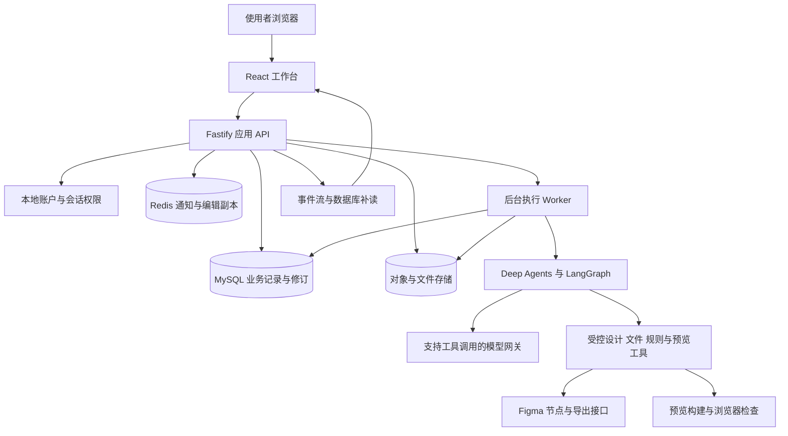
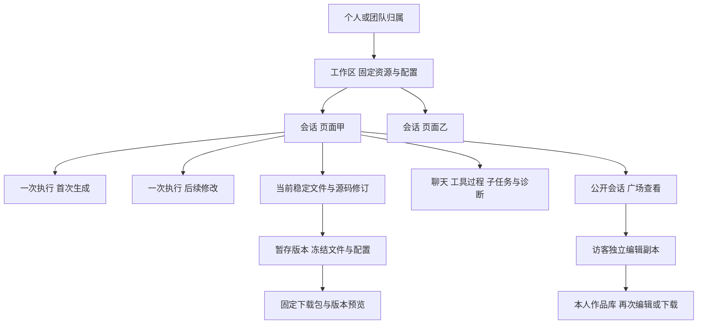
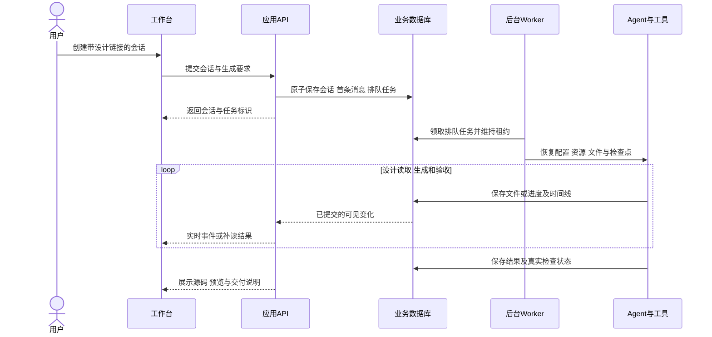
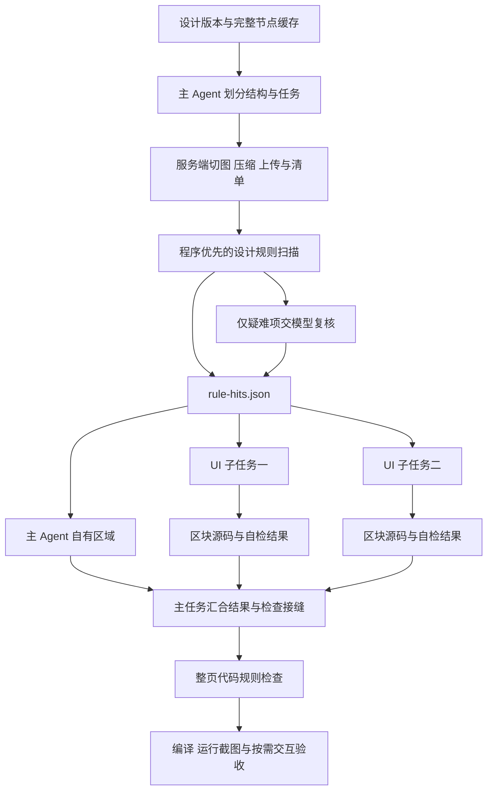
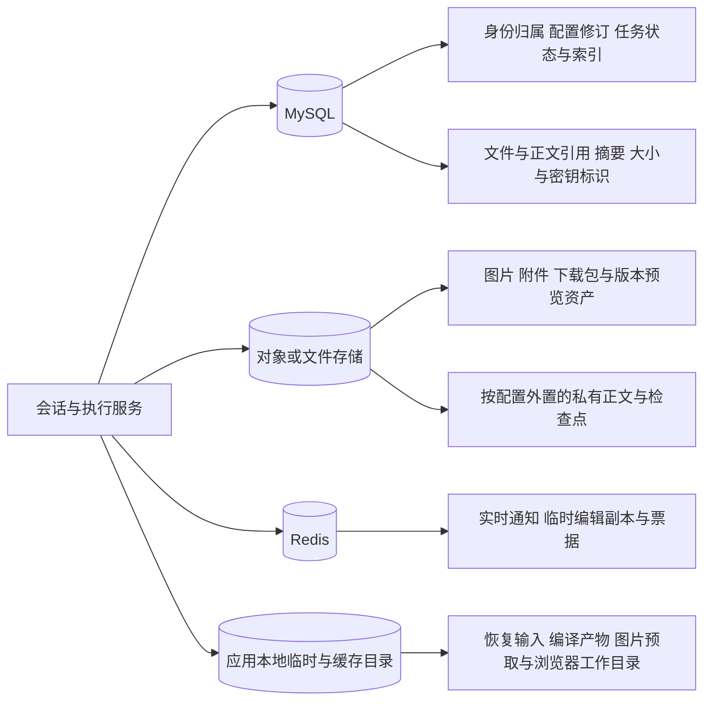
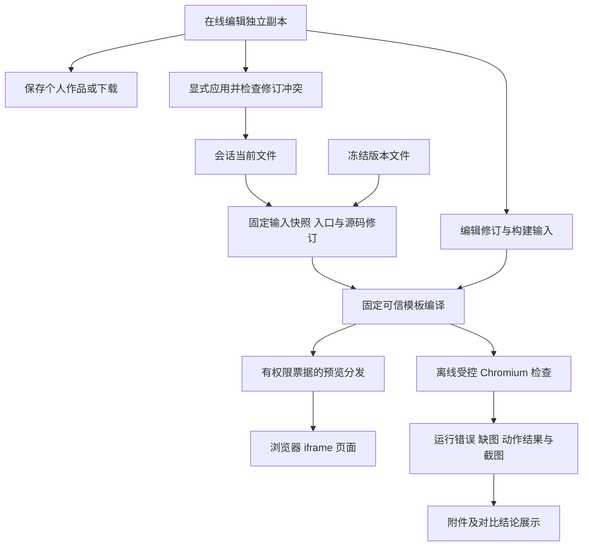
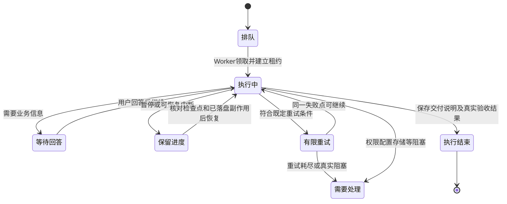

# 架构与流程图

本文从使用者与部署者视角解释组件、执行分工、存储及恢复。完整的设计转代码与验收阶段见[D2C 生成与验收流程](D2C生成与验收流程.md)，源码级参考见[维护资料](../archive/docs/README.md)。

## 1. 系统有哪些部分

前端负责操作、源码与预览展示；后台保存任务并执行。关闭网页不等于取消任务。模型负责决策，设计访问、文件写入、检查和浏览器操作受工具边界约束，不等于模型可以任意执行服务器命令。

应用使用配置中的本地账户登录；运行参数读取项目内配置，文件可保存到本地目录或 S3 兼容对象存储。部署者需要让数据库、缓存和存储在应用重启后仍可访问。

## 2. 工作区、会话、执行、版本与作品的关系

同一个页面继续修改通常沿用原会话；独立页面用新会话。当前文件随修改前进，暂存版本保存当时内容；公开会话与访客作品副本也不是同一份可写数据。公开给所有已登录用户不等于授予他们原工作区写权限。

## 3. 从点击创建到看到进度

没有设计链接的新会话可以保持空闲，随后正常发消息启动。事件通知用于加快更新，持久化时间线用于补读；断线后应从已保存记录接续展示，不靠网页内存作为唯一记录。

## 4. 设计事实、规则和主子任务如何衔接

“先结构扫描，再规则扫描”不是同一项工作重做两遍。前者确定分工，后者建立生成约束；实现者优先读已有报告及同一节点缓存。主任务可与最多两个互斥子任务并行，所需结果汇合后才能做整页动作。

不同范围各自持有报告。子任务限额或交接失败时要返回已经保存的文件与具体缺口，父任务据此继续；接单、扫描完成、源码完成及验收完成分别判断。

## 5. 数据存放在哪里

| 内容 | 持久保存与读取方式 |
| --- | --- |
| 当前源码、冻结文件正文 | 由正文存储策略决定内联或外置；数据库保留定位、修订及完整性信息 |
| 图检查点与中间写入 | 通过对应存储策略保存，恢复时读取原检查点；不是聊天文本拼接后从头执行 |
| 聊天与工具过程 | 持久化时间线与安全展示投影，原始私有执行内容按现有策略管理 |
| 图片、截图附件、版本下载包 | 对象存储保存字节，数据库保留登记信息 |
| 在线编辑副本 | Redis 保存副本与修订，有期限；长期结果需显式保存或应用 |
| 本机构建与图片缓存 | 可回收，用于减少下载和重复编译；不替代稳定数据备份 |

`inline`、`shadow`、`external` 是正文/检查点外置策略，不是预览引擎。外置也不表示所有记录都脱离数据库；阈值、对象大小限制、旧内联数据兼容及配置条件仍生效。历史密钥需保留，不能随意轮换后丢弃。

## 6. 编译、截图和在线编辑

编译器使用固定模板和已准备依赖；用户源码不是任意构建脚本。图片可在构建输入准备时由服务器读取并校验，浏览器检查使用预取资源，页面展示地址与服务器读取路径可以不同。

当前项目的预览执行固定为 `local`，即在应用所在服务器或容器执行。Docker Compose 部署的是完整应用，不表示另外提供 Docker 预览引擎；不提供远程 Sandbox 执行路径。

截图由 Playwright 驱动 Chromium，受动作数、时限、网络及截图尺寸保护。原设计截图、运行截图、代码规则报告和交互观测各自提供不同证据；“可预览”不等于“全部验收通过”。

在线编辑的保存副本与应用回会话源码是分开的动作；广场访客不能借编辑副本覆盖原作者工作区。

## 7. 暂停、中断、重试与恢复

图中是用户可理解的阶段，不与数据库状态枚举逐字对应。恢复会核对已完成文件、子任务交付和有效检查点；不能承诺所有外部副作用都可安全重放，也不能保证所有错误都自动继续。

普通继续保留已有交互验收预算，明确新要求重新核对范围。无法完成时保留文件并说明缺口；执行诊断提供错误次数、错误明细、耗时、用量、排查编号与 runId，供定位阻塞点。

## 8. 判断交付是否完成

1. 有可使用源码与实际图片地址，目标入口能构建。
2. 规则结论对应当前修订；待检查、跳过或失败不能记作通过。
3. 视觉结论对应真实设计与运行截图，并说明覆盖范围。
4. 有交互要求时有真实动作及状态变化证据；RN 网页预览不替代原生端验收。
5. 未完成项、环境限制与后续操作明确，保存或下载的是预期版本。

详细验收图及各类证据的含义见[D2C 生成与验收流程](D2C生成与验收流程.md)。
