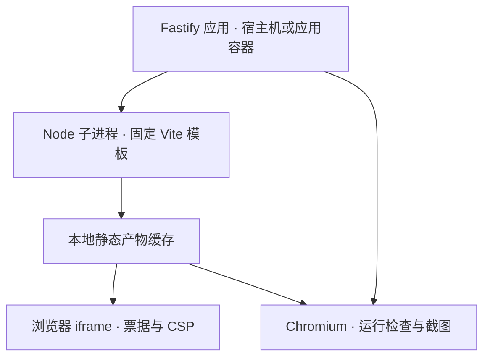
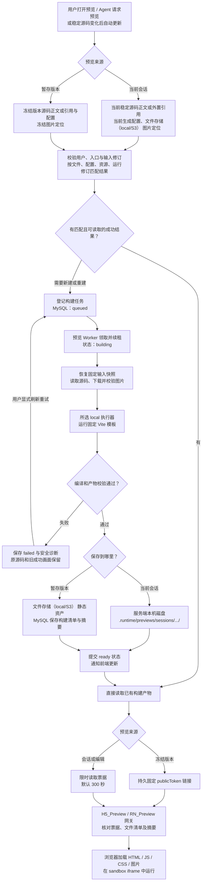
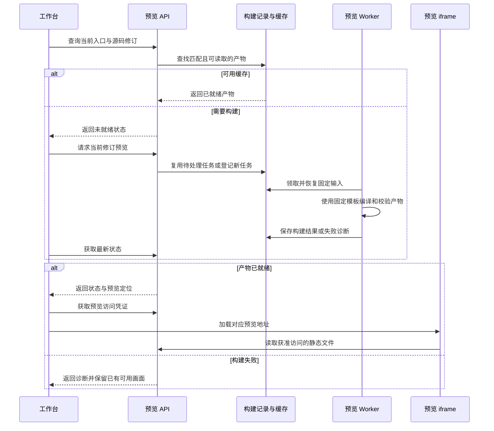
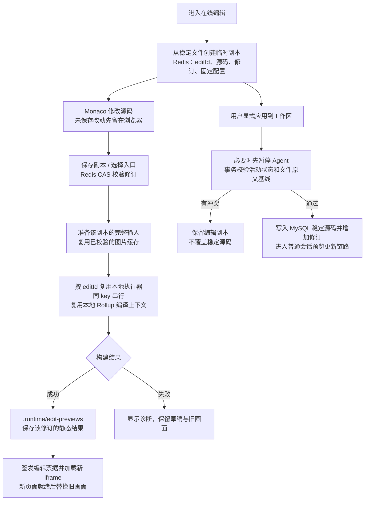
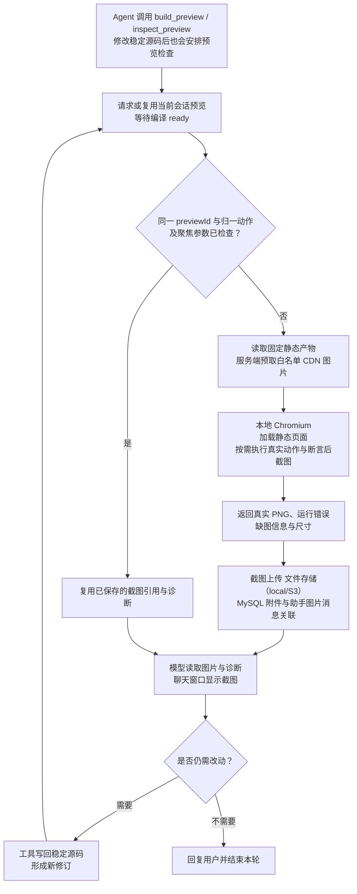

# 预览执行逻辑

核对日期：2026-11-24。对应当前本地执行链；目标发布环境仍需实际验收。

预览分为三件事：**编译源码得到静态文件、浏览器加载这些文件、需要时运行截图反馈给 Agent**。固定 Vite 模板在选定环境中参与编译，浏览器每次访问已有结果时只读取静态文件。

## 1. 执行环境与部署

`src/functions/d2c/preview/engine.ts` 固定为 `local`。在宿主机启动和在 Docker Compose 启动，使用相同的本地执行链。安装阶段执行 `npm run prepare:preview` 准备锁定模板依赖、Chromium 及系统库；每次预览请求不安装依赖。

warm 上下文启动失败可以回退本地冷构建；源码编译错误直接返回诊断。子进程环境不继承模型、数据库和存储密钥；本地执行仍与应用共享服务账号和机器资源，浏览器 iframe 的 sandbox/CSP 单独生效。

## 2. 当前会话与暂存版本：从源码到页面

这里的 Worker 是主应用中的后台代码，与 Agent Worker 分工独立。**HTTP 请求登记任务后，编译由后台完成**；浏览器关闭不取消后台构建。

- 新建请求可复用 queued/building 任务，避免相同输入重复编译。普通 GET 查询不自动重试历史 failed；显式刷新携带重试意图。
- 当前会话的本机缓存缺失或损坏时，从已保存输入恢复重建；不重新生成源码。重建期间可继续展示上次可用结果，不能把旧画面当成最新修订。
- H5 在编译 CSS/SCSS 时按配置基准执行 px→vw；RN 使用 React Native Web、rpx/helper 与静态图片适配。
- 手机视口和显示缩放只改变展示，不触发编译或票据续签；当前视口组件保持同一 iframe。
- 浏览器展示后，“审查元素”和调试面板通过可信脚本读取当前页面；不自动把临时 DOM 修改写回源码。

### 从缓存查询到首次展示

这里以普通会话预览为例。查询和续签凭证不触发重新编译，已有后台任务可被复用。

## 3. 在线编辑：保存草稿与应用源码分开

保存副本只更新 Redis，不改当前会话的稳定源码和历史版本。编辑副本自创建起固定保留 2 小时，保存不续期。warm manager 默认最多保留 2 个上下文，空闲 2 分钟回收；失败、取消、超时或关闭会清理对应执行资源。

编辑状态在构建期间每 500ms 查询，终态停止；新 iframe 载入完成前保持旧画面。本地执行器复用 Rollup 增量编译上下文。构建完成后刷新页面，不保留 React 组件的交互状态。

## 4. Agent 如何拿到截图并继续修复

截图浏览器只读取固定输入及已预取的受控资源；截图成功表示页面真实运行并产生图像，**不等于规则检查通过、视觉还原通过或业务交互验收通过**。截图环境不可用时返回明确失败，不伪造截图、不为环境故障反复改源码。

## 5. 数据分别放在哪里

| 内容 | 位置 | 用途与生命周期 |
| --- | --- | --- |
| 当前源码、冻结版本源码 | MySQL 内联或 contentRef 私有对象引用 | 持久事实源；编译缓存清除后可据此重建 |
| 普通预览任务、状态、清单 | MySQL `d2c_preview` | 排队、领取、失败、成功及产物定位 |
| 原始图片、聊天附件、运行截图 | 文件存储（local/S3）；MySQL 保存定位 | 复用图片和持久展示附件 |
| 当前会话编译结果 | `.runtime/previews/sessions/...` | 最近访问后滑动 30 天，默认总量 2 GiB，容量不足按 LRU 回收 |
| 临时编辑副本 | Redis | 创建起固定 2 小时；过期副本不因磁盘命中恢复 |
| 编辑图片输入 | `.runtime/edit-inputs` | 最近访问后滑动 2 小时，默认独立 2 GiB |
| 编辑编译结果 | `.runtime/edit-previews` | 最近访问后滑动 2 小时，默认独立 2 GiB |
| 暂存版本编译结果 | 文件存储（local/S3）；MySQL 清单 | 随固定版本保存，不跟着当前会话改动 |
| 编译工作目录、warm 控制文件 | OS 临时目录 `pixelprint-preview-*` / `pixelprint-warm-*` | 编译收尾或上下文释放后回收；不作为业务事实源 |
| 模板和执行模式 | 仓库 `preview-template/`、`preview-browser/` | 随应用部署，锁定编译与截图依赖 |

本机缓存不等于跨实例共享存储，部署重建可能提前清空；缓存扫描在启动、每分钟及写入检查时进行。完整规则见[架构文档：缓存清理](架构与流程图.md#51-runtime-何时清理)。

## 6. 顺着代码阅读

| 环节 | 文件 |
| --- | --- |
| 读取执行模式 | [engine.ts](../src/functions/d2c/preview/engine.ts) |
| 普通预览编排、Worker、状态、存储 | [service.ts](../src/functions/d2c/preview/service.ts) |
| 选择冷构建执行器、校验输入和收集输出 | [runner.ts](../src/functions/d2c/preview/runner.ts) |
| 本地增量编译上下文 | [warmRunner.ts](../src/functions/d2c/preview/warmRunner.ts) |
| 固定 Vite 脚本和增量协议 | [build.mjs](../preview-template/container/build.mjs)、[warm.mjs](../preview-template/container/warm.mjs) |
| 编辑副本与应用 | [编辑 service.ts](../src/functions/d2c/edit/service.ts) |
| 限时资源网关 | [runtime.ts](../src/functions/d2c/preview/runtime.ts) |
| 截图输入校验、资源预取、协议解析与执行器选择 | [capture.ts](../src/functions/d2c/preview/capture.ts) |
| 浏览器实际渲染与截图 | [capture.mjs](../preview-browser/capture.mjs) |
| Agent 的构建、截图与反馈编排 | [inspection.ts](../src/functions/d2c/preview/inspection.ts) |
| 截图保存为聊天附件 | [screenshots.ts](../src/functions/d2c/run/screenshots.ts) |

## 7. 当前增补：等待文件、截图覆盖与复验

- **生成中文件未齐**：有活动轮次且已知本地导入文件仍缺失时，可显示“等待文件保存”，保留上次成功画面；依赖补齐后再构建。语法错误、缺包、非法路径及冻结版本失败不伪装成等待。普通刷新/票据续签与显式重试分别处理。
- **展示视口与编译分离**：手机视口、缩放及全屏用于查看现有构建，不因切换比例重签票据或编译；当前组件复用同一 iframe。新源码构建后的页面更新仍可能重置应用状态。
- **截图和交互**：inspect_preview 支持唯一 CSS 选择器、最多12个 click/swipe/scroll/expect 动作及 focusSelector。点击或滑动后要检查选中态、滚动位置等实际变化；只截图不能证明交互有效。
- **覆盖范围**：截图限制12,000px/10MiB，返回 page/focused 和实际覆盖范围，区分高度、字节及内部滚动。可定点截取长页面底部，不把未覆盖部分记为已验收。
- **缓存身份**：截图复用须同时匹配 previewId 与归一动作/聚焦参数；同一页面不同交互计划或位置产生独立证据，不能拿旧图验新修订。
- **修复与收敛**：首次生成的修复阶段按批次安排真实复验；已有源码的交互增量默认一轮验收加最多两次复验，普通继续沿用预算。未通过则保留文件并说明缺口，不无限截图或用口头完成替代证据。

整体流程和各类检查的区别见[D2C 生成与验收流程](D2C生成与验收流程.md)，数据关系见[架构与流程图](架构与流程图.md)。
